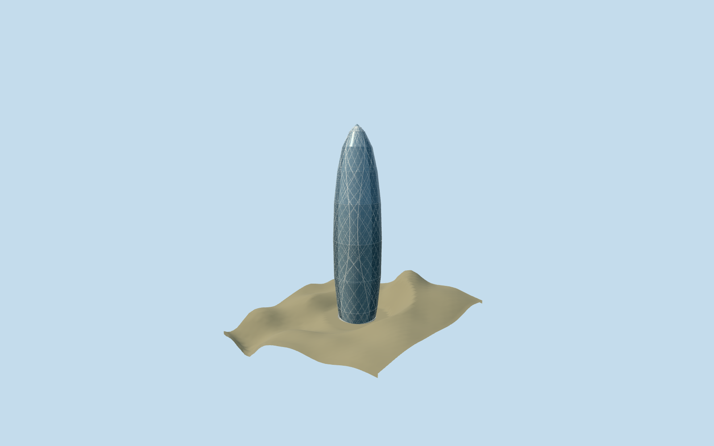

# Mode Gakuen Cocoon Tower

Budgeted Cocoon Tower exterior: curved threefold glass skin, sharper pictured crown, three atrium seams and wrapping white web. Detailed source master independently preserved.

## Evidence and reconstruction

Published dimensions and reconstructed details are separated in spec.json. Primary references:

- [Reference](https://www.tangeweb.com/works/works_no-188/)
- [Reference](https://www.tangeweb.com/project/modegakuen/)
- [Reference](https://www.arup.com/projects/the-arup-journal-2000s/the-arup-journal-2009-issue-2/)

No third-party geometry, photograph or bitmap texture is embedded. Shared surface graphs come from the central library; vertex tints carry model colors. Glazing uses PBR materials; transparent surfaces are declared per model.

## Model and axes

59,070 triangles; 177,210 vertices; 3 material groups; 7,090,780 bytes. Native bounds: -27.499, 0.000, -24.975 to 25.246, 203.650, 24.975. Source hash: `sha256:1d83de725cd3ba013e6dcf5db5ffd1c2ecfad72250bb60eba430fef6a6d3ce1f`.

{"up":"+Y","longitudinal":"+X along the mapped building long axis","front":"+Z","origin":"Ground-level center of exact-QID mapped footprint frame"}

One inspected architect exterior picture confirms the bulging/tapered cocoon, three-face glass and white wrapping web. Browser crown narrows to a tip in response to the picture; original blunt-crown master remains independently reproducible. Retain203.65m authored height, existing52.584×47.427m mapped envelope, exact-QID anchor and long axis. Standard viewer PMTiles confirms the Shinjuku tower/road context. Threefold facade phase and local entrances remain approximate. PMTiles off-footprint point[0,40]43.8772m sets approximate terrain contact; center69.1239m contains building imprint. Bounded preview contact removes that imprint while raw samples remain available. Separate egg-shaped hall, exact panel/strand counts, basement and threshold surveys are excluded.

## Reproduce

Run `node packages/worldgen/scripts/generate-signature-towers.mjs --ids=N0137` (or add `--check`). The generator preserves manually edited masters by checking their baseline hashes. Import through the standard authored-model workflow with optimization disabled; then capture all QA cameras, including shared-surface views.

## Pending work

- One inspected architect exterior picture confirms the bulging/tapered cocoon, three-face glass and white wrapping web. Browser crown narrows to a tip in response to the picture; original blunt-crown master remains independently reproducible. Retain203.65m authored height, existing52.584×47.427m mapped envelope, exact-QID anchor and long axis. Standard viewer PMTiles confirms the Shinjuku tower/road context. Threefold facade phase and local entrances remain approximate. PMTiles off-footprint point[0,40]43.8772m sets approximate terrain contact; center69.1239m contains building imprint. Bounded preview contact removes that imprint while raw samples remain available. Separate egg-shaped hall, exact panel/strand counts, basement and threshold surveys are excluded.
- Shared concrete and painted-metal graphs reused; glazing uses reusable opaque PBR parameters without photographic textures. Skyline merges web into broad bands; closer tiers add representative crossing strands and panel frames. Exact floor divisions, aluminum routing and doorway details are approximations. Physical-device timings unmeasured.

This bundle follows the medium-fi standard. Medium-fi appearance and geographic fit are reviewed separately. Hash-bound visual acceptance is recorded separately after capture inspection.
