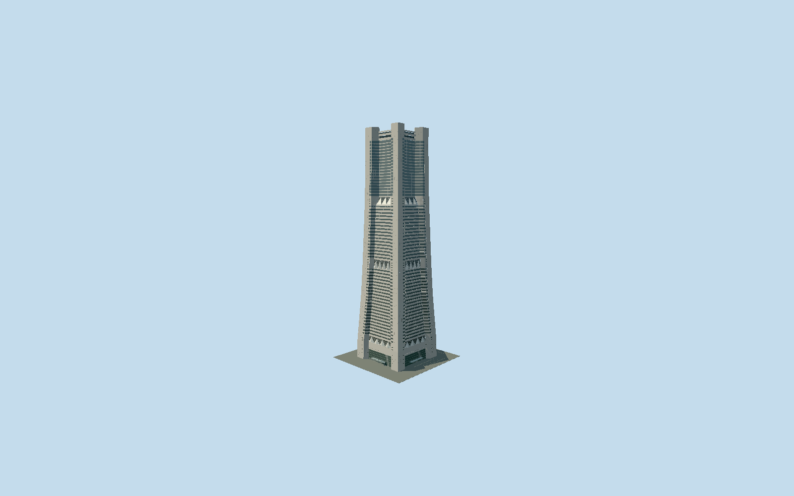

# Yokohama Landmark Tower

The 1993 four-corner granite tower: gently narrowing square shaft with deep recessed ribbons, creased triangular transition panels, glazed upper hotel, projecting crown piers and a recessed mechanical roof.

## Evidence and reconstruction

Published dimensions and reconstructed details are separated in spec.json. Primary references:

- [Reference](https://www.mjd.co.jp/en/projects/29294/?lang=en)
- [Reference](https://office.mec.co.jp/en/search/detail/011701)
- [Reference](https://office.mec.co.jp/storage/buildings/011701/figure/011701_std_plan_01_org_a.jpg)
- [Reference](https://www.usmodernist.org/WORLD/WA-1997-61.pdf)
- [Reference](https://www.skyscrapercenter.com/yokohama/landmark-tower/547/)
- [Reference](https://www.openstreetmap.org/way/64891750)

No third-party geometry, photograph or bitmap texture is embedded. Shared surface graphs come from the central library; vertex tints carry model colors. Glazing uses PBR materials; transparent surfaces are declared per model.

## Model and axes

63,342 triangles; 178,510 vertices; 3 material groups; 7,188,828 bytes. Native bounds: -37.200, 0.000, -37.200 to 37.200, 296.300, 37.200. Source hash: `sha256:a1897da07d99154df5ab13607c7da8f4db8553ac113e81b1873ce7433e9d75ea`.

{"up":"+Y","longitudinal":"+X southeast","front":"four similar faces; reconstructed symmetric entries","origin":"Mapped tower-only frame at reconstructed street grade"}

Fresh OSM API2026-10-10 confirms exact Q587108 tower64891750, unchanged from independent source-local map-frame; adjacent shopping mall45537790 remains excluded. Signed heading−0.9963155525273629 puts+X southeast and+Z southwest, corroborated by owner20F north arrow pointing native upper-left. Owner19.66+27+19.66=66.32m plan width constrains the20F shaft; mapped roughly74.9m ground envelope and reconstructed74.4m model are distinct. Four similar sides are treated symmetrically: tower-only glazing, doors and canopies are reconstructed on all four faces, not surveyed entrance locations. SourceY0 is reconstructed street entry/grade. CVU296.3m architectural/tip and273m occupied remain distinct from owner rounded296m/70occupied+threepenthouse floors. Accept2m main-envelope/1degree reconstruction allowance; no automatic footprint replacement. Adjacent mall, separate pavilion, interior fit-out and surrounding landscape excluded.

## Reproduce

Run `node packages/worldgen/scripts/generate-signature-towers.mjs --ids=N0189` (or add `--check`). The generator preserves manually edited masters by checking their baseline hashes. Import through the standard authored-model workflow with optimization disabled; then capture all QA cameras, including shared-surface views.

## Pending work

- Original93742triangles/10852416byte master remains exactly reproducible from unchanged recipe. Reviewed source retains all58 modeled ribbon floor datums, narrow pier slits, three groups of4/4/3 creased folds, recessed hotel panes, projecting granite corner crown piers and three crown bars per face, mechanical roof/plant/rods and symmetric tower-only entries. It reduces granite panel joints, seal width subdivisions, louvre repeats and tube sampling; all original small detail remains available through original recipe. The canopy now faces upward and downward explicitly. Skyline averages facade ribbons and shared graph colours into one group, retaining all folds, recessed crown and four coarse supported canopies while omitting plant/rods/fine seams/door details. District restores coarse ribbon cadence, roof equipment and reconstructed entry frames; street restores all ribbon heights with proud slit patches and planar sill trim, sparse louvres and no fold-edge tubes/door handles; close-up restores fine seals, closed sills, reveal depth, tubes and handles. Granite and coated-metal graphs approximate stone, roof concrete and stainless trim with three near draw groups, zero embedded images. Intermediate heights/fold projection, entry compass identity and plant details remain reconstructed. Finite along-ray1.5/.75/.3/.1m main-surface comparisons exclude omitted narrow trim/hardware; no global geometric-error, surveyed grade or device-performance claim.

This bundle follows the medium-fi standard. Medium-fi appearance and geographic fit are reviewed separately. Hash-bound visual acceptance is recorded separately after capture inspection.
