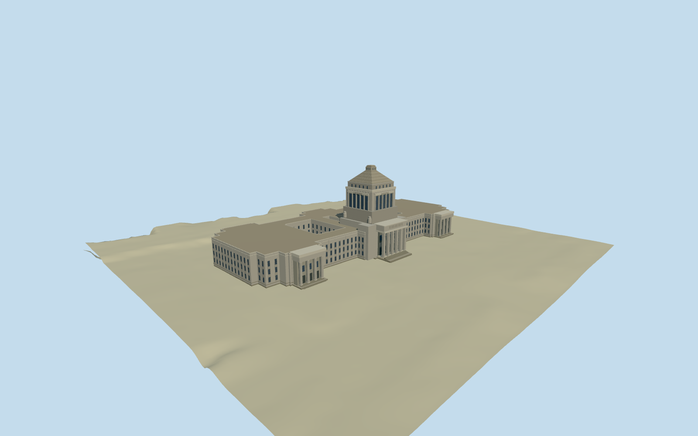

# National Diet Building

Japan’s National Diet Building with symmetrical granite wings, open courtyards, and the stepped central tower.

Authoring state: **review-in-qa.json**. Current completion evidence is in [qa.json](qa.json) and the [completion ledger](../../../../qualla-structures/batches/qualla-004.PROGRESS.md).

- [National Diet Building: The Door That Never Opens](https://qualla.com/national-diet-building/)

Façade and tower trim are reconstructed from the public-domain views, documented heights, and the mapped footprint.

Windows on service elevations and roof service elements are approximate.

Scope includes the main Diet Building, its open courts and immediate entry stairs. Detached office blocks are outside the structure envelope.

Build: `node content/worldgen/source/places/xn/xn7/national_diet_building/models/generate-national-diet-building.mjs`. Add `--check` to verify exact regeneration. 34592 triangles; 7 materials; no embedded photographs.
