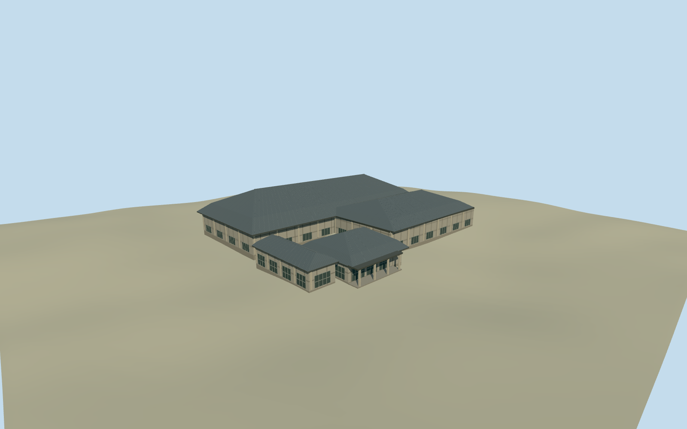

# National Noh Theatre

The National Noh Theatre in Sendagaya, with broad gray hipped roofs and a recessed entry porch on pale piers.

Authoring state: **review-in-qa.json**. Current completion evidence is in [qa.json](qa.json) and the [completion ledger](../../../../qualla-structures/batches/qualla-004.PROGRESS.md).

- [National Noh Theatre](https://qualla.com/national-noh-theatre/)

Standing principal auditorium and the mapped visitor-side ranges. Interior stage, freestanding landscaping and nearby non-theatre buildings are outside scope.

Height, rear fenestration and some connections are interpreted from the mapped plan and exterior photograph.

Build: `node content/worldgen/source/places/xn/xn7/national_noh_theatre/models/generate-national-noh-theatre.mjs`. Add `--check` to verify exact regeneration. 8323 triangles; 7 materials; no embedded photographs.
