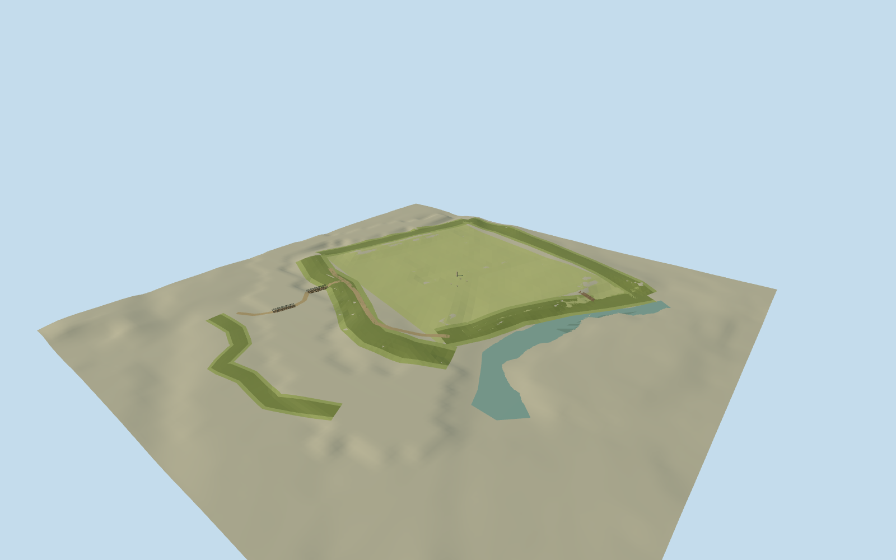

# Oda Castle

The existing Oda Castle inner enclosure, grassed earth ramparts, east moat and visitor bridges.

Authoring state: **review-in-qa.json**. Current completion evidence is in [qa.json](qa.json) and the [completion ledger](../../../../qualla-structures/batches/qualla-004.PROGRESS.md).

- [Oda Castle: The Fortress That Refused to Stay Lost](https://qualla.com/oda-castle/)

The model describes the existing earthwork, moat and low park structures. The wider castle district and conjectural medieval superstructures are outside this model.

Wooden walkway width, small landscape details and seasonal water extent are representative. Ground elevations and bank alignment use the published GSI field.

Build: `node content/worldgen/source/places/xn/xn7/oda_castle/models/generate-oda-castle.mjs`. Add `--check` to verify exact regeneration. 5425 triangles; 5 materials; no embedded photographs.
