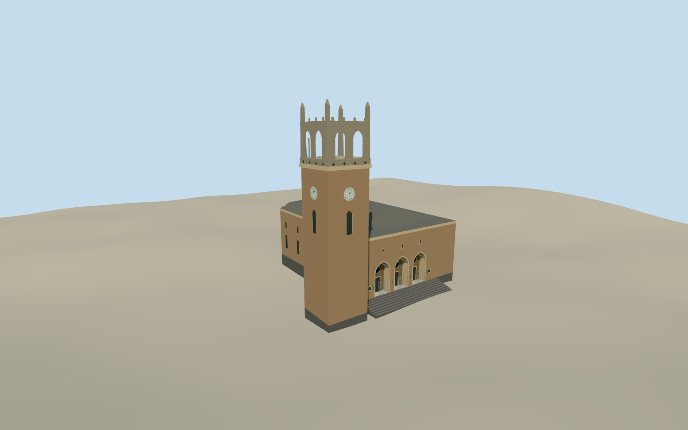

# Ōkuma Auditorium

The 2024 Ōkuma Auditorium on the Waseda campus, with three recessed Tudor arches and a 38-meter clock tower crowned by open Gothic tracery.

Authoring state: **review-in-qa.json**. Current completion evidence is in [qa.json](qa.json) and the [completion ledger](../../../../qualla-structures/batches/qualla-003.PROGRESS.md).

- [Okuma Auditorium: The Bells That Ring Like Westminster](https://qualla.com/okuma-auditorium/)

The auditorium uses the native footprint, mapped entrance and documented 38-meter tower. The hidden main roof profile, side openings, trim heights and crown dimensions are approximate.

The source elevation field is unchanged. Entry thresholds, stair geometry and foundation exposure are approximate.

The model is the permanent 2024 auditorium exterior. Interiors, adjacent high-rise, statue and separate grounds are outside scope.

Build: `node content/worldgen/source/places/xn/xn7/okuma_auditorium/models/generate-okuma-auditorium.mjs`. Add `--check` to verify exact regeneration. 3279 triangles; 5 materials; no embedded photographs.
