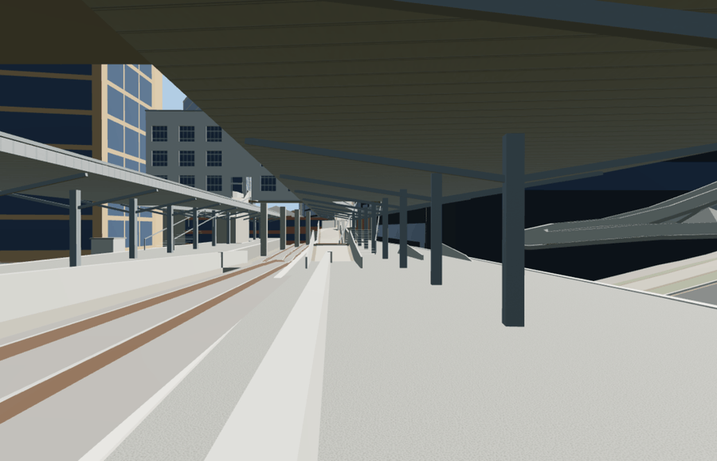

# Shibuya Station

All ten current portable exterior views inspected. Both whole mapped JR platforms and their longitudinal canopies, Hachiko-side entrance frontage, central raised concourse, new south hall, south platform covers, complete Ginza terminal with white M-section roof/ribs, east deck, curved west passage/connecting link and service block are present. Near geometry includes glazing recesses, pale roof ribs, supports/braces, fascia/soffits, platform edges, four explicitly estimated stair flights and two-sided railings. This pass corrected brace alignment, repeated trim, stair openings through the raised hall floors, closed canopy edges and the distant M-roof plan so all tiers follow the mapped width changes. Hidden facade bays, intermediate floor levels, JR canopy sections and changing construction details are medium-fi interpretations. No copied signs, adverts, ticket interfaces, logos, people, trains or navigable railway interiors.

The viewer keeps one common Hachiko reference at about 34.91 m. Local grades clear the raised western passage and the station service room. The JR track bed meets the platform edges while the railway and road records remain in place. The focused fixture replaces nine station feature records and retains the other 1,553 buildings and all 1,344 road and rail records.

Failed loading preserves the native layers. Eviction restores the ground and releases model geometry.

| Detail level | Triangles | Download bytes | Draws |
| --- | ---: | ---: | ---: |
| skyline | 971 | 86,660 | 1 |
| district | 3,986 | 347,656 | 6 |
| street | 10,438 | 910,820 | 6 |
| closeup | 26,284 | 2,340,252 | 6 |

Skyline and district total 434,316 bytes. Six GLBs pass Khronos validation and contain zero embedded images. Five shared material graphs bind in the viewer. The review covers 79 renders and 95 geographic samples.

The station model follows the retained mapped JR and Ginza exterior. Platform levels and urban terrain contacts are approximate.

The raised Ginza deck, west passage and platform halls keep their modeled relative heights. Neighboring commercial developments and the underground transit network use native map context.

[Mapped site frame](map-frame.json) · [Terrain fit](site-fit.json) · [QA evidence](qa.json)
