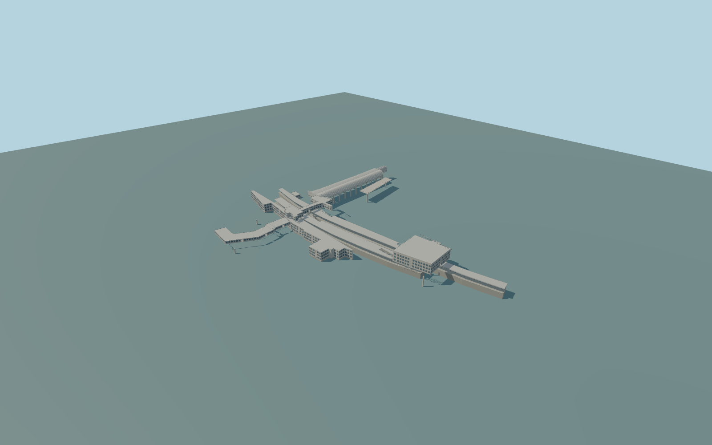

# Shibuya Station

Complete source model of the mapped above-ground Shibuya JR/Ginza passenger-station exterior: both whole mapped JR island platforms and longitudinal canopy families, the Hachiko-side entrance frontage, central raised concourse, new south hall and south platform covers, the full elevated Ginza terminal with its characteristic white M-section roof/ribs, the mapped east pedestrian deck, west curved connecting passage and small station service block. Preserve independent Shibuya Scramble Square, Hikarie, Stream, Fukuras, Sakura Stage, Mark City/Keio host buildings, surrounding property, streets and rail network. Underground Tokyu/metro concourses and the Keio terminal inside its independent Mark City host have no invented separate above-ground building. Current unfinished redevelopment is not replaced by an imagined completed future complex. No trains, people, brands, adverts, lettering, ticket interfaces or navigable railway interiors.

Rebuild: `node packages/worldgen/scripts/generate-shibuya-station.mjs`;append `--check` for exact source bytes. Select import/LOD/placement with `--ids=shibuya_station`. Detailed source and four browser tiers are separate ignored GLB outputs.

Complete source model of the mapped above-ground Shibuya JR/Ginza passenger-station exterior: both whole mapped JR island platforms and longitudinal canopy families, the Hachiko-side entrance frontage, central raised concourse, new south hall and south platform covers, the full elevated Ginza terminal with its characteristic white M-section roof/ribs, the mapped east pedestrian deck, west curved connecting passage and small station service block. Preserve independent Shibuya Scramble Square, Hikarie, Stream, Fukuras, Sakura Stage, Mark City/Keio host buildings, surrounding property, streets and rail network. Underground Tokyu/metro concourses and the Keio terminal inside its independent Mark City host have no invented separate above-ground building. Current unfinished redevelopment is not replaced by an imagined completed future complex. No trains, people, brands, adverts, lettering, ticket interfaces or navigable railway interiors.

Current standard PMTiles retain exact mapped station/terminal footprints and platform polygons. Ordinary 2026 aerial and builder photographs resolve the station frame, surrounding separate towers, concrete entry, white M-section Ginza roof and repeated ribs. Main low station roof11m, Ginza roof19m, east deck13.7m, south hall23.5m and service3.9m follow native height tags; JR platform floor6.2m, raised concourse floor12m and its roof18m, Ginza floor12m and west passage floor6.5m are explicit medium-fi estimates. Hidden JR canopy sections, facade bays, intermediate station levels, live construction inventory and exact platform/road clearances remain approximate. Four illustrative platform stair flights connect the central/south raised halls to the actual platform polygons. Their exact hidden layout is not a surveyed floor plan. Clear roof slots are built around each flight. All station levels are fixed to one common standard field datum 34.911286m at [-65,20]; the unmodified urban field is retained even where roof/vegetation returns conflict with actual railway levels.

Ordinary recent aerial, street and builder photographs plus standard PMTiles; no bespoke survey. Mapped outlines and height tags are retained. Intermediate floors, hidden facade inventory, roof sections, JR access layout and changing redevelopment details are medium-fi estimates. Exact railway/road clearances, present construction state and accessible thresholds are unverified. Standard urban terrain may intersect raised platforms/frontages and must remain an explicit pending placement issue if observed. Physical laptop/phone/dense-city timing and numerical LOD errors remain unmeasured.

Five existing 256px shared graphs: concrete_plain, stone_granite, metal_standing_seam, metal_painted and window_grid. Six merged near semantic groups and one far palette group; metric UVs and linear colours. No embedded/private images. Actual glazing alone uses window_grid. Roofs, concrete, opaque metal panels and pale painted ribs retain their proper shared slots. All four tiers retain both whole JR platform polygons, the Ginza M-roof, mapped halls/passages and complete west connecting link. Near tiers add rib/column families, glazing recesses, facade frames, platform edge bands and two-sided stair/deck railings. Stair roof slots follow the explicitly estimated source flights. No claimed surveyed floor plan.

Original geometry:repository license. Map:© OpenStreetMap contributors,ODbL-1.0;Protomaps. Standard terrain:terrain-grid.json. Ordinary pictures stay local and are not redistributed or used as textures. Current acceptance:qa.json.
