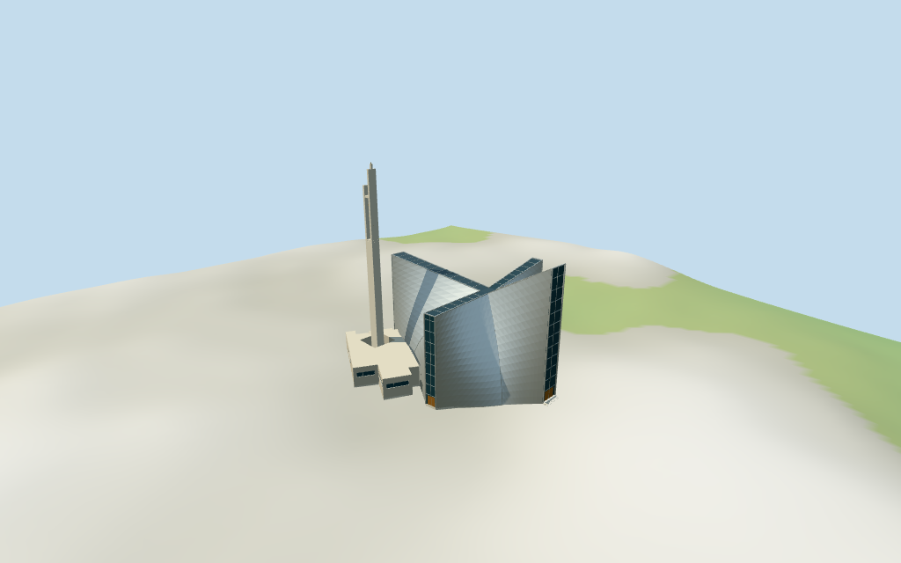

# st_marys_cathedral_tokyo — St. Mary's Cathedral review

Reviewed2026-10-15 against current source/runtime bytes. Accepted for the medium-fi exterior and approximate geographic/terrain scope.

## Built result

Inspected all11 current portable/source-terrain frames. Tokyo St. Mary's Cathedral has eight curved silver stainless-steel sails, a narrow cross-shaped roof skylight, unequal tall glazed end slots, steel ribs and lower wood doors. Low beige annexes surround the western shell feet; a detached slender concrete belfry has unequal blades and a real upper bell aperture. Corrected vertical tip-cell winding against local ruled-surface normals, independently for each triangle; distant LOD tips now face outward. Individual ruled panels retain deliberate flat facets in keeping with the medium-fi architectural style. Low shell feet are partly obscured by attached annexes. Fine panel fabrication, full room plans and exact glazing artwork are outside scope.

Medium-fi exterior from three inspected Commons building/belfry photographs, one viewed-only architect aerial and current standard viewer PMTiles/DEM. No bespoke surveys, drawings or archival research. Eight curved steel sails, cross skylight, tall glass ends, low annexes and unequal-blade detached belfry are individually authored. Steel joint fabrication, engineering-exact shell equations, stained-glass art, hidden annex/interior plans, exact bell count/proportions, sculpture, inscriptions, neighboring halls and certified walking are excluded or approximate. Photo attribution retained; no reference photos redistributed. Physical laptop/phone timings remain pending.

## Shared materials and placement

Inspected all11 current shared/geographic frames. Four existing cached256-square stainless steel, concrete, granite and plain wood graphs serve six merged groups. Metric UVs, linear silver/beige/wood tints and flat architectural normals; glazing and bell accents use flat geometric PBR colors. Zero embedded images, bespoke facade maps or baked shadows. Graphs read once; unload disposes geometry, leaves zero live model geometries and restores ground. Top placement follows both raw mapped controls, with independent estimated bell tower/courtyard. Close detail views intentionally crop parts; whole views include the complete belfry. Flat diagnostic ground can conceal below-datum foundations; source-terrain preview shows approximate contact.

Exact-QID OSM way120704384/Q1193480 matches current main35184492793216. Both raw controls remain exact after rigid rotation: main45-vertex envelope and12-vertex cross skylight part35184492793214. Anchor[139.726526164,35.714287404], heading-0.4231293275906802rad follows the long roof-spine edge, signed by long western arm, high eastern glass end and southwest belfry/long hall relationship in the aerial. Main height/min_height and part min_height remain absent. Part40m describes the narrow cross roof envelope, not a solid whole church. Retained39.4m main height controls high eastern shell tip. Center27.5m, west30m, north32m, south26.5m, low annex6m, valley feet and shell subdivisions are picture estimates. Eight ruled surfaces approximate hypar sails rather than exact structural equations. Bell center[-13,16]m,3.2x2.6m footprint,61.6m auxiliary height, blades/bells and8x8m courtyard pocket are independently picture/context-estimated, with5m location/5degree heading uncertainty; no bell control exists in standard PMTiles. Bell height is separate from retained39.4m church fact. Boolean inputs round0.1mm while raw plans stay exact. All36 viewer checks cover both selected controls and preserve three neighboring buildings plus a west approach patch across six outputs. Standard DEM datum30.944234m, floor0.4m, perimeter-0.06..2.81m. Side foundations follow coarse terrain; bell base local DEM+0.15m. Entry steps/thresholds are visual estimates. Exact courtyard grading, cuts/fills, paving/steps/ramps/thresholds, absolute altitude and walking remain unverified. No global flattening or road replacement.

Inspected all27 current Earth-lighting frames: Economy/High, noon/late, three distances, silhouette, six detail crops, four matched whole-model LODs and four transitions. Skyline keeps eight sails, cross slots, low annexes and open belfry silhouette. District adds cached shared surfaces, doors and coarse glazing/bells. Street adds inner shell thickness, skylight mullions, recessed closed end glazing and annex ribbon openings. Closeup/master refine curve tessellation and bell bodies. All four matched whole-model cameras include the full belfry and church. Coarse distant panel faceting is intentional; geometry probes verify the outward tip triangles. Synthetic cottage/ground context is a fixture, not Tokyo urban or terrain evidence.

## Browser budgets

| Level | Triangles | Bytes | Draws |
| --- | ---: | ---: | ---: |
| skyline | 532 | 55388 | 1 |
| district | 2310 | 193824 | 6 |
| street | 6732 | 590260 | 6 |
| closeup | 11020 | 1042100 | 6 |

Initial skyline plus district: **249212bytes** of geometry. Master: **1326044bytes / 11020triangles**. Four cached shared256² graphs, zero embedded images. Bytes exclude graph definitions/texture generation. Split POSITION/NORMAL streams; equal CPU/GPU totals. Physical device timing pending.

## Verification

- Targeted byte reproduction; source/import/LOD/input/review hashes and source/recipe inventory/schema match.
- Six Khronos validations: zero errors/warnings/images. Four browser budgets pass.
- Two rigid raw map controls, full tags/absent heights,39.4m main tip, independently estimated bell, derived partitions and standard DEM match.
- **716 imported geometry probes** and **36 actual viewer footprint checks** pass.
- Shared graph read-once/unload, hash-bound placement and medium-fi review pass.
- Scene validation and30-tick simulation: sha256:9460db24dcc268679d07439101ef8d2f9f52d7ed67892dfec4c0f9de1ca039bd.
- Inspected **49 current frames**:11portable,11shared/placement,27medium-fi. Camera/path/hash reports retained; bulk images ignored.

Source hash:sha256:d5ae7c9140d64e144bad46d51a5874d6e516e30cf414769cb4536e623b328472. Runtime hash:sha256:346e69e1da60bba5793a893686a3ba3c35ebc9556f2c503ee44bc4096f574c40. Input hash:sha256:d9120f42c3fde84cc160e1522568070651787fbf9fea4ab857a9a229a5d32795.

Commands: targeted generate/import/LOD/register-landmark-previews --ids=st_marys_cathedral_tokyo; generate-additional-landmarks.mjs --ids=st_marys_cathedral_tokyo --check; capture-structure-models.mjs --ids=st_marys_cathedral_tokyo --reflections --antialias --fit-shadows; capture-landmark-library.mjs --ids=st_marys_cathedral_tokyo --reflections --adaptive-clipping --bounded-placement; capture-medium-fi.mjs --ids=st_marys_cathedral_tokyo --reflections; molen validate; molen sim run --ticks30 --hash. Routine full source checkpoint covers ljubljana_cathedral–saint_sophia_cathedral_in_polotsk.

## Limits

- Retained exact-QID OSM way120704384/Q1193480 matches current main35184492793216. Its full45-vertex low-envelope plan and current12-vertex cross skylight part35184492793214 remain rigidly rotated, without rescaling; absent height/min_height on main and absent min_height on part remain absent. The part40m tag describes the narrow roof cross envelope, not a solid whole church. Retained39.4m fact controls main high eastern shell tip; center27.5m, western30m, north32m, south26.5m, low annex6m, panel valley feet and internal subdivisions are picture estimates. Eight ruled curved sails approximate the exterior, not engineering-exact hyperbolic paraboloids. Bell tower position[-13,16]m,3.2x2.6m footprint,61.6m auxiliary height, unequal blades/bells and8x8m courtyard pocket are picture/context estimates with5m position/5degree orientation uncertainty, not PMTiles controls or surveyed data. Tower height is separate from39.4m main shell fact. Derived Boolean inputs round0.1mm; raw plans stay exact.
- Standard viewer DEM datum 30.944234m; display offset0.4m, mapped perimeter terrain -0.06..2.81m. Side footings follow coarse terrain. Bell base uses local DEM+0.15m; main entry steps/threshold estimate uses local DEM+0.2m with a short visual transition to shell floor. Exact courtyard grading, cuts/fills, steps/ramps/thresholds, absolute altitude and walking remain unverified. No global flattening or road replacement.
- Medium-fi exterior from three useful Commons building/belfry photos, one architect aerial and current standard PMTiles/DEM only. Eight ruled surfaces approximate the hypar shells; steel panel fabrication/joints, exact structural geometry, glass artwork, modern hidden annex/interior plans, bell count/proportions, sculpture, inscriptions, neighboring halls, surveyed paving/thresholds and certified walking excluded or approximate. Belfry/courtyard are explicitly picture-estimated rather than mapped. Physical laptop/phone timing pending.
- Skyline keeps eight sails, cross slots, annexes and open belfry silhouette. District adds cached surfaces, wood doors and coarse glazing/bells. Street adds shell inner thickness, skylight mullions, recessed closed glazing and annex ribbon openings; closeup/master refine curve tessellation and bells. Synthetic cottage context is a review fixture.

Readiness accepts this exterior scope. The1,000-candidate goal remains incomplete.
