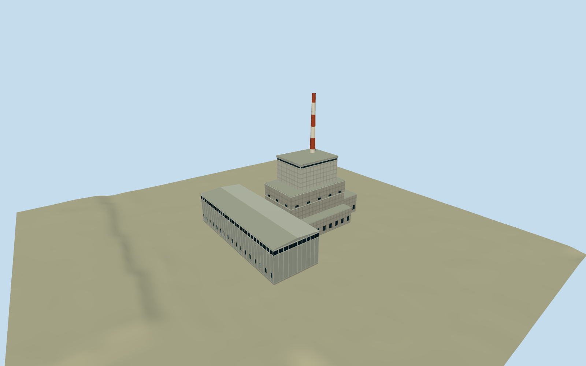

# Tōkai Power Station

The original Tōkai Power Station silhouette around 1967, with its banded chimney, concrete main hall and long pale industrial hall.

Authoring state: **review-in-qa.json**. Current completion evidence is in [qa.json](qa.json) and the [completion ledger](../../../../qualla-structures/batches/qualla-003.PROGRESS.md).

- [Tokai Nuclear Power Plant](https://qualla.com/t-kai-nuclear-power-plant/)

The archival photograph is undated. The selected January 1967 viewing date represents the early standalone appearance after the July 1966 opening. The viewing range ends before construction of the neighboring second station.

The named main envelope and historic chimney height are documented. Chimney and annex placement, roof heights, clerestories and the silhouette of the long hall are interpreted from the public aerial photograph. This edition covers the historic exterior buildings.

Build: `node content/worldgen/source/places/xn/xn7/tokai_nuclear_power_plant/models/generate-tokai-nuclear-power-plant.mjs`. Add `--check` to verify exact regeneration. 2044 triangles; 7 materials; no embedded photographs.
