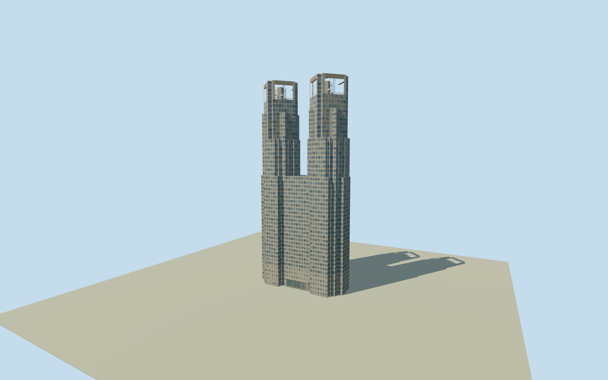

# Tokyo Metropolitan Government Main Building No. 1

Kenzo Tange’s Main Building No. 1 in Nishi-Shinjuku, with its broad granite base, closely gridded facade, two tall stepped towers and open crowns.

Authoring state: **review-in-qa.json**. Current completion evidence is in [qa.json](qa.json) and the [completion ledger](../../../../qualla-structures/batches/qualla-003.PROGRESS.md).

- [Tokyo Metropolitan Government Building: The Cathedral of Bureaucracy](https://qualla.com/tokyo-metropolitan-government-building/)

Includes standing Main Building No. 1 and its entrance facades. The separately mapped No. 2, assembly, station, sculpture, artwork and raised public footbridges remain outside model geometry.

Native footprint, setbacks and documented 243.4 m rise determine scale. Window bay spacing, exact granite patterns, pilotis, rooftop mechanical fixtures and lighting details are reconstructed.

The site grade and foundation use Japan’s official DEM5A. The frozen global DEM independently shows rooftop and urban artifacts. Runtime snaps to its ordinary terrain provider. Plaza and entrance grades remain approximate.

Build: `node content/worldgen/source/places/xn/xn7/tokyo_metropolitan_government_building/models/generate-tokyo-metropolitan-government.mjs`. Add `--check` to verify exact regeneration. 22444 triangles; 5 materials; no embedded photographs.
