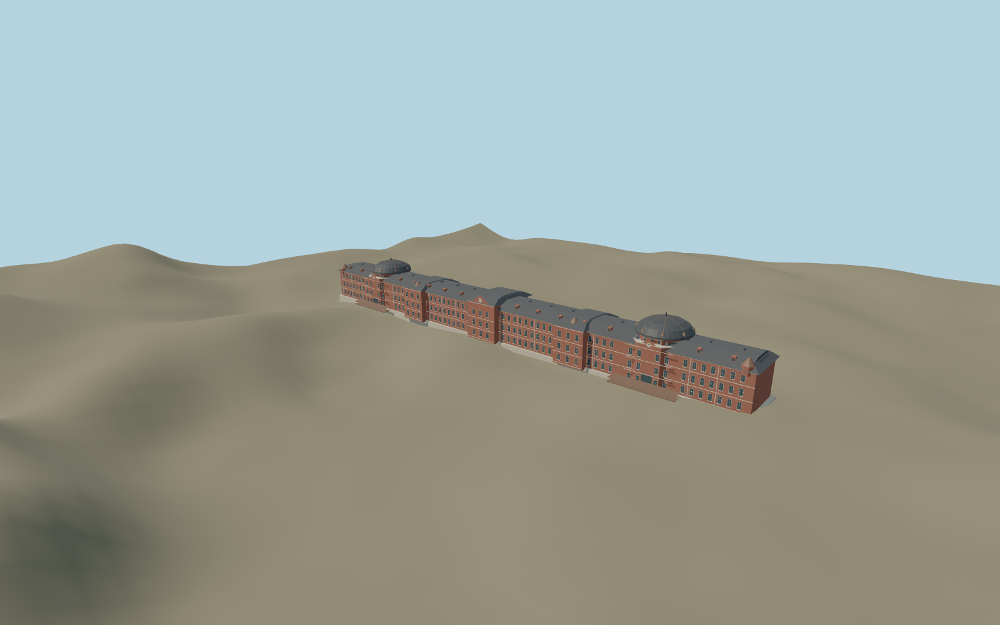

# Tokyo Station — tokyo_station

Current medium-fi Marunouchi exterior using picture/PMTiles fit. The prior coarse draft remains reproducible in the unchanged buildTokyoStation function; a separate reviewed recipe improves dome curvature, three storeys and entrance/roof identity.

Source geometry: `packages/worldgen/scripts/tokyo-station-model.mjs`. The original draft builder remains unchanged in `generate-landmark-models.mjs`; its exact historical bytes are tested independently. All current models and four browser levels are rebuilt from checked-in recipes. No copied survey mesh, private image or embedded texture.

Shared surfaces: matgraph:molen.worldgen.material.brick, matgraph:molen.worldgen.material.metal_standing_seam, matgraph:molen.worldgen.material.slate, matgraph:molen.worldgen.material.stone_limestone_raw. Signed placement, references and accepted limits live in `map-frame.json`, `reference-metadata.json`, `review-scope.json` and [QA review](QA-REVIEW.md).

Rebuild only this item with `node packages/worldgen/scripts/generate-landmark-models.mjs --ids=tokyo_station`; import using the same ID and regenerate its browser levels. GLBs are build outputs.
