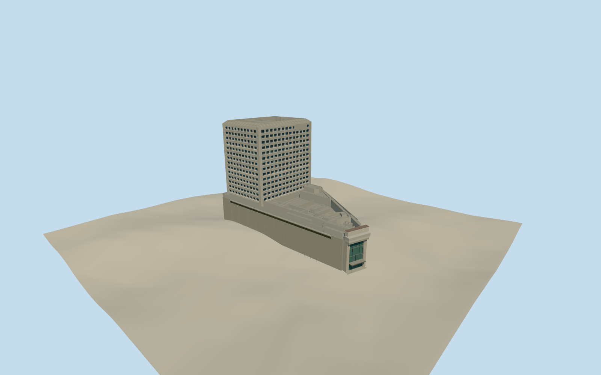

# Tokyo Stock Exchange

Tokyo Stock Exchange’s modern monumental market building in Kabutocho, with a granite entrance, set-back glazing, ribbon windows and the office tower behind.

Authoring state: **review-in-qa.json**. Current completion evidence is in [qa.json](qa.json) and the [completion ledger](../../../../qualla-structures/batches/qualla-003.PROGRESS.md).

- [Tokyo Stock Exchange](https://qualla.com/tokyo-stock-exchange/)

Fine window placement, roof hardware and cantilever details are estimated from the exterior originals and measured massing. The local numerical model was aligned to the project ground datum and the documented 78.8 m height. Foundation and entrance steps are fitted to source terrain.

The street facade is represented as a standing exterior. Interiors, commercial signs and adjoining unrelated structures sit outside the scope.

Build: `node content/worldgen/source/places/xn/xn7/tokyo_stock_exchange/models/generate-tokyo-stock-exchange.mjs`. Add `--check` to verify exact regeneration. 21548 triangles; 5 materials; no embedded photographs.
