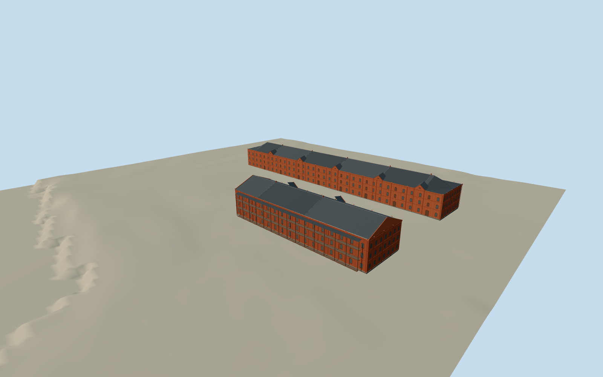

# Yokohama Red Brick Warehouse

Shinko’s two red brick commercial warehouses, with the shorter post-earthquake hall, loading galleries, punched openings and repeated gables across the open event plaza.

Authoring state: **review-in-qa.json**. Current completion evidence is in [qa.json](qa.json) and the [completion ledger](../../../../qualla-structures/batches/qualla-003.PROGRESS.md).

- [Yokohama Red Brick Warehouse](https://qualla.com/yokohama-red-brick-warehouse/)

The model covers both post-2002 warehouse exteriors. The Japanese national elevation data provide the first-order ground contact.

Window and pier rhythms, local roof partitions and secondary awning details are estimates from the accepted 2003 plaza view. Anonymous earlier photographs were excluded.

The city’s published overall dimensions and present-day mapped outlines establish both volumes. The railway remains, interiors and event installations are outside the exterior scope.

Build: `node content/worldgen/source/places/xn/xn7/yokohama_red_brick_warehouse/models/generate-yokohama-red-brick-warehouse.mjs`. Add `--check` to verify exact regeneration. 16779 triangles; 5 materials; no embedded photographs.
