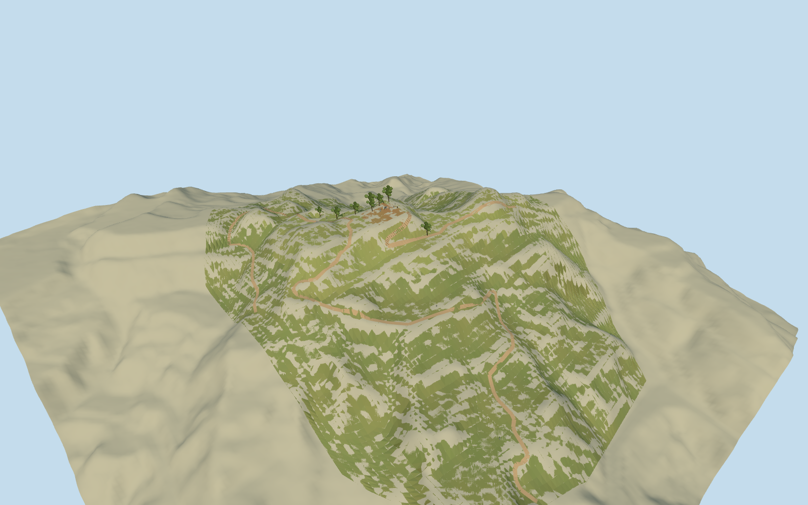

# Kasugayama Castle

Kasugayama Castle’s engineered hilltop platforms, approach steps, well terrace and preserved summit markers.

Authoring state: **review-in-qa.json**. Current completion evidence is in [qa.json](qa.json) and the [completion ledger](../../../../qualla-structures/batches/qualla-004.PROGRESS.md).

- [Kasugayama Castle: Fortress of the Dragon of Echigo](https://qualla.com/kasugayama-castle/)

This central ridge model ends above the wider eastern castle grounds and excludes the modern shrine, outer defensive perimeter and reconstructed gate features.

The terrain is survey-derived. The featured summit marker and signs match the exterior photograph in form. Individual plants, trail surfaces, furnishings and stone inscriptions are represented approximately.

Build: `node content/worldgen/source/places/xn/xnd/kasugayama_castle/models/generate-kasugayama-castle.mjs`. Add `--check` to verify exact regeneration. 20525 triangles; 5 materials; no embedded photographs.
