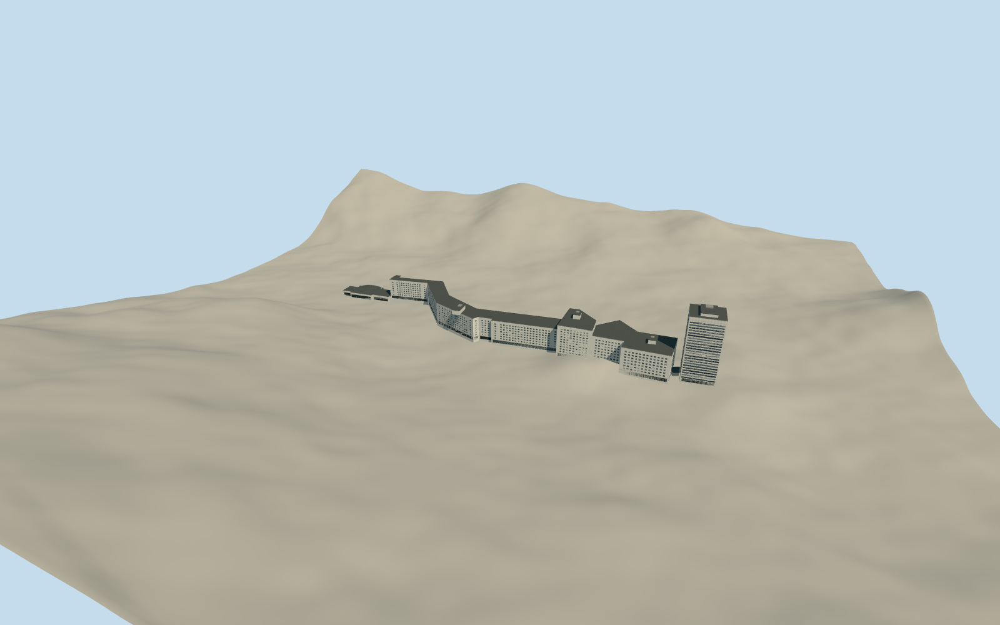

# Naeba Prince Hotel and Ski Center

The Naeba resort base with the striped Prince Hotel tower, curved ranks of pale hotel wings, and glazed day-trip ski centre.

Authoring state: **review-in-qa.json**. Current completion evidence is in [qa.json](qa.json) and the [completion ledger](../../../../qualla-structures/batches/qualla-003.PROGRESS.md).

- [Naeba Ski Resort: Snow, Song, and the Longest Gondola in Japan](https://qualla.com/naeba-ski-resort/)

The exterior represents the Naeba resort base in late December 2025. The long hotel wings and tower use the three cleared same-day images. A cleared 2018 image informs the low day-trip arrival hall.

Five mapped footprints and the operator’s floor ranges constrain the massing. Roof plant, covered links, individual windows and heights without surveyed controls are approximate. Only the base buildings are modeled.

The 1,024 m original Terrarium field is preserved. The sampled site grade and lower service foundations are approximate.

Build: `node content/worldgen/source/places/xn/xnd/naeba_ski_resort/models/generate-naeba-ski-resort.mjs`. Add `--check` to verify exact regeneration. 8835 triangles; 5 materials; no embedded photographs.
