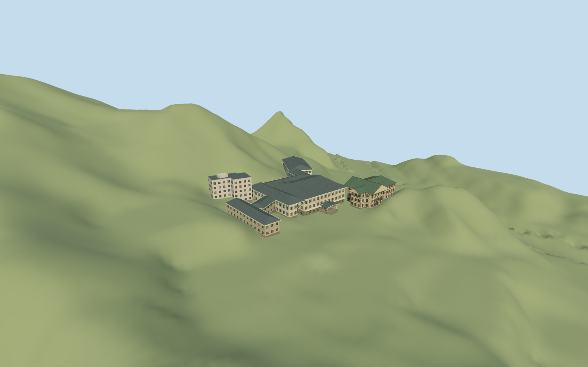

# Nikkō Kanaya Hotel

The standing hillside hotel in Nikkō, with the 1893 clapboard Main over its stone ground floor, the early New Building, copper-roofed Annex and 1961 Second New Building.

Authoring state: **review-in-qa.json**. Current completion evidence is in [qa.json](qa.json) and the [completion ledger](../../../../qualla-structures/batches/qualla-003.PROGRESS.md).

- [Nikko Kanaya Hotel](https://qualla.com/nikk-kanaya-hotel/)

The footprint of the outdoor stair and porte-cochère, heights, shutters, rail spacing, material colors and modern service details are approximate.

The standing hotel is modeled, including the raised stone plinth under the historic timber hotel. The early archival photo guides the upper timber floors and period architectural details.

The detached garden viewing pavilions, landscaped features, signs, interior fittings and courtyard furnishings are outside this exterior model.

Build: `node content/worldgen/source/places/xn/xne/nikko_kanaya_hotel/models/generate-nikko-kanaya-hotel.mjs`. Add `--check` to verify exact regeneration. 24842 triangles; 6 materials; no embedded photographs.
