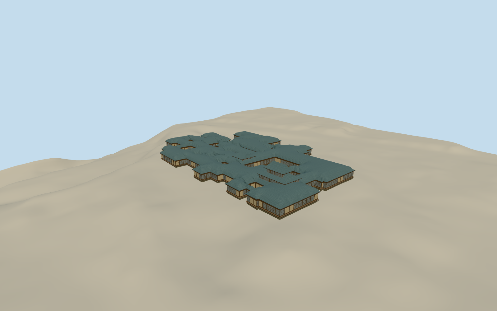

# Tamozawa Imperial Villa

The restored Tamozawa Imperial Villa with its joined blue-gray copper roofs, dark wood verandas, small courtyards and the taller residence incorporated into the complex.

Authoring state: **review-in-qa.json**. Current completion evidence is in [qa.json](qa.json) and the [completion ledger](../../../../qualla-structures/batches/qualla-003.PROGRESS.md).

- [Tamozawa Imperial Villa: Three Eras Under One Roof](https://qualla.com/tamozawa-imperial-villa/)

The 16 mapped openings and perimeter place the overall extent. Roof-ridge layout, section dimensions and window spacing require interpretation from partial exterior views. The approximate garden-side position and height of the central pavilion are inferred from the photograph and the heritage description.

The original 5 m GSI grade, overhang footprint, and written internal floor area describe different quantities. Roof eaves are based on map extent and the building walls are recessed.

The detached demolished annex, interiors, park paths and garden planting are outside the planned model scope.

Build: `node content/worldgen/source/places/xn/xne/tamozawa_imperial_villa/models/generate-tamozawa-imperial-villa.mjs`. Add `--check` to verify exact regeneration. 25888 triangles; 6 materials; no embedded photographs.
