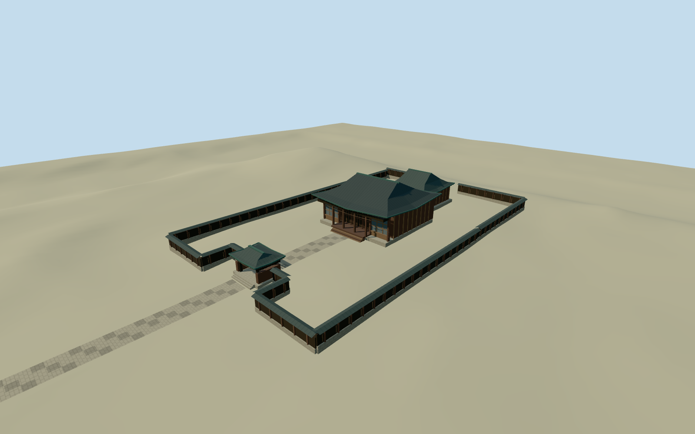

# Uesugi Shrine

Historic Yonezawa shrine with a swept gray-green worship-hall roof, enclosed rear sanctuary, timber entrance and stone torii.

Authoring state: **review-in-qa.json**. Current completion evidence is in [qa.json](qa.json) and the [completion ledger](../../../../qualla-structures/batches/qualla-004.PROGRESS.md).

- [Yonezawa Castle](https://qualla.com/yonezawa-castle/)

The model depicts the standing shrine buildings, enclosure and torii. The demolished castle buildings, outer moat, treasure hall and separate Matsugasaki Shrine are outside its scope.

Roof heights, rear-facing finish details and hand-carved fittings are approximate. The entrance is presented without seasonal crowds, snow, temporary decorations or inscriptions.

Build: `node content/worldgen/source/places/xn/xne/uesugi_shrine/models/generate-uesugi-shrine.mjs`. Add `--check` to verify exact regeneration. 7312 triangles; 5 materials; no embedded photographs.
