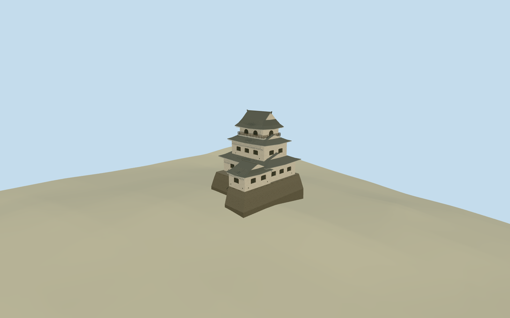

# Shiroishi Castle

The timber keep of Shiroishi Castle with white plaster, tiered gray tile roofs, gallery and battered stone foundation.

Authoring state: **review-in-qa.json**. Current completion evidence is in [qa.json](qa.json) and the [completion ledger](../../../../qualla-structures/batches/qualla-004.PROGRESS.md).

- [Shiroishi Castle: The Rebel Stronghold That Defied a Revolution](https://qualla.com/shiroishi-castle/)

The reconstructed keep, attached projecting roof and battered foundation. The wider park, detached gates and moat are outside scope.

Batter profiles, sash placement and small roof ornaments are estimated.

Build: `node content/worldgen/source/places/xn/xng/shiroishi_castle/models/generate-shiroishi-castle.mjs`. Add `--check` to verify exact regeneration. 7786 triangles; 5 materials; no embedded photographs.
