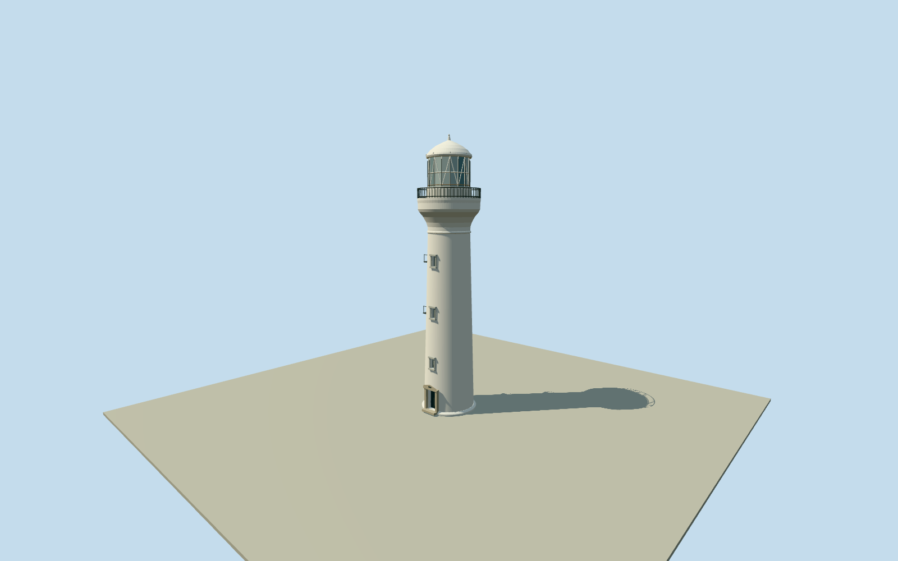

# Inubōsaki Lighthouse

Complete white Inubosaki masonry tower: tapered shaft/base, three narrow stone-trimmed stair-window recesses and bounded entrance/pediment, expanding corbelled gallery/solid pale belt/open dark railings, white upper pedestal, diagonally braced polygonal glazed lantern/domed roof/pinnacle, plus bounded side maintenance ladder/two small landings. Operator31.3mstructuralheight, not52msea-to-light. Exact named native point anchors a photographically estimated circular plan; no surveyed footprint or detached station/keeper/museum/mast/compound-wall/landscape geometry.

Authoring state: **review-in-qa.json**. Current completion evidence is in [qa.json](qa.json) and the [completion ledger](../../../../qualla-structures/batches/qualla-002.PROGRESS.md).

- [Inubosaki Lighthouse](https://qualla.com/inub-saki-lighthouse/)

Exact named OSMlighthousenode1582440591/Q6059232is the original horizontal identity/position control. No mapped circular tower footprint is supplied by this native extract; nearby4corner buildingways681122781–785/681357784are detached facilities and are excluded. A3.22mbase-radius circle/shaft taper and west-southwest front bearing are bounded estimates from the accepted Qualla originals, not surveyed native polygon vertices. Native point, story coordinate and coarse official sexagesimal position differ by roughly10–20m; horizontal threshold/precise alignment and host contact remain unverified preview estimates. Operator31.3mstructuralheight/CoastGuardabout27mground-to-light and52mwater-to-light are distinct; do not extrude a52m-tall tower.

The complete individual named lighthouse tower is modeled. Detached keeper/signal/communications/ticket/museum/foghorn buildings and masts, compound wall, white postbox, coast/landscape and visitors are separate and excluded. Native map supplies a point only; circular3.22mbase radius/2.94to2.4mshaft taper, WSWfront bearing, window/door sections and collar/gallery/lantern subdivisions are photographic estimates. Native point/story/coarse official coordinates differ roughly10–20m; precise horizontal position/threshold/host contact remain unverified preview estimates.

Operatorstructuralheight31.3m/JapanCoastGuardabout31m, with lightabout27maboveground/52mabovesea, are distinct. Modeltip31.3m and glass centerabout27m preserve that distinction. Fine masonry thickness/paint, optical apparatus/shutters, lens Fresnel segments, exact railing/mullion counts, dome sections, lettering/plaques and fixtures are medium-fi approximations; no exact interior optics or emissive light beam.

Two exact4032x2268August2025Aspereown-workCC0exterior originals and2048x1536Abasaaown-workPD-self2013tower view were inspected first from Qualla. Native imageSHA1/primary same-author dedications match local cleared bytes.2013view supports bounded side ladder/two small landings on otherwise less-visible side; their exact current persistence/sections remain approximate. The separate white postbox close-up, other licensed images/museum-lens displays/paintings and nearby station structures are unused. Operator/CoastGuardtext supplies height facts only; no additional image source or photographic texture.

Three close-detail front windows/door are genuinely recessed; main gallery rails and white diagonally braced lantern frame remain open geometric features. Fine bars/maintenance rungs, roof vents and subdivisions retire progressively with distance. Only a bounded base/threshold is included; raw source relief is retained, without fitted/flattened coastal ground.

Build: `node packages/worldgen/scripts/generate-authored-places.mjs --ids=inubosaki_lighthouse`. Add `--check` to verify exact regeneration. 10515 triangles; 6 materials; no embedded photographs.
