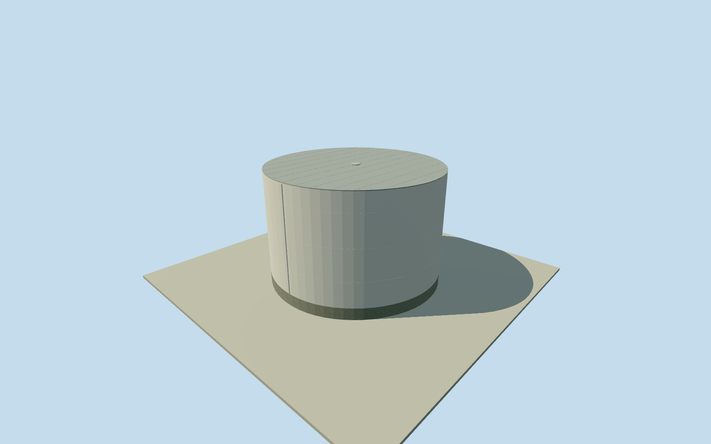

# Daiichi southeast cylindrical tank

Whole independently positioned approximatecirca1971southeast cylindrical tank: all16savedcompiledoutercontrols/fullwhitecylindricalwall/lowclosedgrayroof/base and estimatedsmallroofaccesslid/servicepipe. 11mheight estimated from clearedaerial/localtankproportions,3muncertainty; no nativeheighttag exists; exact1971footprintcontinuity/function/detail unverified. Other separate tanks, turbinehall/pumphouse/reactor/stack/roads/water excluded; wholeplant unfinished. Whole saved contemporarycompiled near-circular building35184476008698, southeast of first completed turbinehall, all16originalnumerical controls; no heighttag exists,11mheight estimated from clearedaerial/localtankproportions. Cleared oppositeDOEcirca1971aerials show a smooth white cylindrical tank with lowclosedgrayroof in the corresponding forecourt. Currenttohistoriccorner continuity and exactsame tank identity are approximate,8mregistration/3mheight uncertainty. No functional water/condensate identity claimed; no siteparcel or other tank bodies filled. Whole16corner currentcompilednear-circular envelope retained at everyLOD, with fullsmoothwhitewall/closedflatgrayroof/base and smallestimatedrooflid/servicepipe. No nativeheighttag exists.11m mainroofabovefloor estimated from clearedaerial/localtankproportions,3mheightuncertainty. Currenttohistoriccornercontinuity and exacttankidentity unverified,8mregistrationuncertainty; exactprocess/storagefunction unknown, no water/condensate claim. Two oppositealreadyclearedDOEcirca1971aerials personally inspected for this new tank. Southeastfirst-turbineforecourt showswhitecylindricalbody/closedlowgrayroof. Hidden rearwall continuesconservatively. Fineweldlines/coursecensus/roofseams/.5mrooflid/shortsidepipe form/facing/finish are estimates with1mcomponent uncertainty; no unsupported fullcircumferentialrailing or ladder added. Original256m129x129field/16641heights/2rawtiles/datum13.2767m fixed before floor.25m/foundation-1.1..+.25m/eave11.17m/mainroof11.25m. Originalcornergrades-.47356..+.83065m, local grade/body registration approximate; closingbase is estimatedburiedextension, not surveyedfoundation. No field/frame/floor/mainsection cut/mask/flatten/refetch/refit after construction or captures. Smoothwhitepaintedsteel interpretation and lowgrayclosedroof followclearedoriginals; weldlines/lid/pipe are conservativeestimates. FourLODsretainfull16cornerbody/allwalls/roof/base/lid/servicepipe; finejoints reduce atdistance. All16originalcontrolpoints retained. District/street/closeup add2/4/4radial arc segments between each originalpair, up toabout.18m beyondoriginalstraightchords; curved cylinder interpolation is an explicit visualization estimate, not surveyedcurvature/CAD. No photographic texture, artwork or machinery/interior copied. Qualla-first25families/zeroconflicts previously screened; exacttwoalreadyclearedpublishedDOEgovernmentworkoriginals reused. Sharednativebyte/provenanceproof unchanged, no fresh rights campaign or metadata repair. No new/questionable imagery adopted; acceptedreactor/turbine/stack and allpreviousmodels unchanged. Approximate1971-06-01historicalphase/currentWorldEligiblefalse. Otherseparatetanks/pumphouses/turbine/reactor/exhauststack/roads/water/sitecliff are separate. Wholeplant remainsunfinished; one tank doesnotcomplete it.

Authoring state: **review-in-qa.json**. Current completion evidence is in [qa.json](qa.json) and the [completion ledger](../../../../qualla-structures/batches/qualla-002.PROGRESS.md).

- [Fukushima Daiichi Nuclear Power Plant](https://qualla.com/fukushima-daiichi-nuclear-power-plant/)

Whole independently positioned approximatecirca1971southeast cylindrical tank: all16savedcompiledoutercontrols/fullwhitecylindricalwall/lowclosedgrayroof/base and estimatedsmallroofaccesslid/servicepipe. 11mheight estimated from clearedaerial/localtankproportions,3muncertainty; no nativeheighttag exists; exact1971footprintcontinuity/function/detail unverified. Other separate tanks, turbinehall/pumphouse/reactor/stack/roads/water excluded; wholeplant unfinished.

Whole saved contemporarycompiled near-circular building35184476008698, southeast of first completed turbinehall, all16originalnumerical controls; no heighttag exists,11mheight estimated from clearedaerial/localtankproportions. Cleared oppositeDOEcirca1971aerials show a smooth white cylindrical tank with lowclosedgrayroof in the corresponding forecourt. Currenttohistoriccorner continuity and exactsame tank identity are approximate,8mregistration/3mheight uncertainty. No functional water/condensate identity claimed; no siteparcel or other tank bodies filled.

Whole16corner currentcompilednear-circular envelope retained at everyLOD, with fullsmoothwhitewall/closedflatgrayroof/base and smallestimatedrooflid/servicepipe. No nativeheighttag exists.11m mainroofabovefloor estimated from clearedaerial/localtankproportions,3mheightuncertainty. Currenttohistoriccornercontinuity and exacttankidentity unverified,8mregistrationuncertainty; exactprocess/storagefunction unknown, no water/condensate claim.

Two oppositealreadyclearedDOEcirca1971aerials personally inspected for this new tank. Southeastfirst-turbineforecourt showswhitecylindricalbody/closedlowgrayroof. Hidden rearwall continuesconservatively. Fineweldlines/coursecensus/roofseams/.5mrooflid/shortsidepipe form/facing/finish are estimates with1mcomponent uncertainty; no unsupported fullcircumferentialrailing or ladder added.

Original256m129x129field/16641heights/2rawtiles/datum13.2767m fixed before floor.25m/foundation-1.1..+.25m/eave11.17m/mainroof11.25m. Originalcornergrades-.47356..+.83065m, local grade/body registration approximate; closingbase is estimatedburiedextension, not surveyedfoundation. No field/frame/floor/mainsection cut/mask/flatten/refetch/refit after construction or captures.

Smoothwhitepaintedsteel interpretation and lowgrayclosedroof followclearedoriginals; weldlines/lid/pipe are conservativeestimates. FourLODsretainfull16cornerbody/allwalls/roof/base/lid/servicepipe; finejoints reduce atdistance. All16originalcontrolpoints retained. District/street/closeup add2/4/4radial arc segments between each originalpair, up toabout.18m beyondoriginalstraightchords; curved cylinder interpolation is an explicit visualization estimate, not surveyedcurvature/CAD. No photographic texture, artwork or machinery/interior copied.

Qualla-first25families/zeroconflicts previously screened; exacttwoalreadyclearedpublishedDOEgovernmentworkoriginals reused. Sharednativebyte/provenanceproof unchanged, no fresh rights campaign or metadata repair. No new/questionable imagery adopted; acceptedreactor/turbine/stack and allpreviousmodels unchanged.

Approximate1971-06-01historicalphase/currentWorldEligiblefalse. Otherseparatetanks/pumphouses/turbine/reactor/exhauststack/roads/water/sitecliff are separate. Wholeplant remainsunfinished; one tank doesnotcomplete it.

Build: `node content/worldgen/source/places/xn/xns/daiichi_southeast_cylindrical_tank/models/generate-house.mjs`. Add `--check` to verify exact regeneration. 3244 triangles; 5 materials; no embedded photographs.
