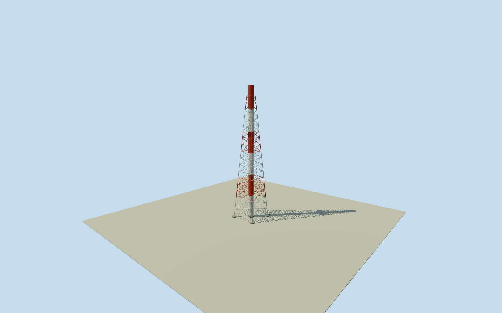

# Daiichi turbine ventilation exhaust stack

Whole centralizedturbineventilationstack:120mflue/fullestimated111msteelframe/braces/fourpiers/centralpad/hollowmouth/oneestimated80mmaintenanceplatform/ladder. Originalfourcornertowerquad retained asapproxlegcontext; roleinferredfromsouthernlocation/four-stackcensus. Frameheight10m/legrole4m/top3m/bore2m/platformheight10m/details2m estimates. Allappearanceimageryunused;2021continuity/grade unverified.

Authoring state: **review-in-qa.json**. Current completion evidence is in [qa.json](qa.json) and the [completion ledger](../../../../qualla-structures/batches/qualla-002.PROGRESS.md).

- [Fukushima Daiichi Nuclear Power Plant](https://qualla.com/fukushima-daiichi-nuclear-power-plant/)

Whole approximately reconstructed centralizedturbineventilationstack servingUnits2/3/4turbine andcentralwastebuildingventilation:120mflue,estimated111mfourlegsteel frame/fullbraces,oneestimatedmaintenanceplatform/ladder,fourpiers/centralpad/hollowmouth. Originalfourcornermappedtowerenvelope retained as approximatebasecontext; roleinferredfromsouth-ofUnit4location/four-stackcensus. Not the separate3/4sharedstack or a waste-buildingproxy. Exactframe/bore/footing/platformdimensions andpaint explicitlyestimated. Allappearanceimageryunused;Qualla-first25families/zero conflicts,cleared1971DOEoriginals do notbindthisstack andnotapplied. Originalindexedlicensecomparison notesidentifyallfourstacksphysical120mandcentralventilationfunction forUnits2-4/centralwastebuilding. Originaloperator2019census discussescentralsteel members/maintenanceaccess. Bothhonestly retained as indexedfactcache,not originalPDFbytes; no fresh403retries. ActualoriginalOSMway743332934is southernmostof fourmappedflare/towerquads andsuppliesapproximateposition/outline. Centralventilationidentityis inferred,not explicitnative name. Frame111mheight10muncertainty/top5.4m3muncertainty/fluebore4.4m2muncertainty/legrole4m andone80mplatform10mheightuncertainty are author estimates,not exactsourcefacts. Genericfamilydimensions referenced only as context. Finish/bracecensus/ladder/feet details2m estimated.2021continuity/gradeunverified,currentfalse; everyreportfigure/plan/photo/map/satellitepixelunused.

Originalindexedoperatorlicensecomparison note1 givesphysical120mheight foreachoriginalstack;note2 identifiescentralventilationfunction forUnits2/3/4turbines andcentralwastebuilding. Original2019operatorfour-stackinspection distinguishescentralizedturbineventilationsteelmembers andmaintenanceaccess. These are honestindexedfactcache records,not originalPDFbytes. Everyreportphoto/figure/planpixelunused.

OriginalOSMway743332934fourpointflare/towerquad southofUnit4 suppliesapproximateposition/basecontext. Assignmentascentralventilationstack is spatial/census inference,not explicitnative name. Fourmappedcornerlegrole4m uncertainty; not footing/steel survey. Another3/4-areaquad has RemoteMonitoringSystemTowername, preservedasconflict,not an explicitexhaustidentity. Existingacceptedmodels/QA unchanged.

111msteelbodyheight10muncertainty/topspan5.4m3muncertainty/fluebore4.4m2muncertainty are authorfamily estimates,not exactcentral-stackdimensions. Fourfootings4.6mdiameter/centralpad6.4mdiameter/pipewall.05m andbracecensus/memberwidths/linear taper/paint2m estimates. One80mmaintenanceplatform with10mheightuncertainty is an explicitauthorcensus/location choice,not a measured reportlevel orcount; platformdeck/rail/ladder dimensions2m estimated. Original1/2familyreport is comparisoncontext only.

Fluehasfull120mheight/hollowmouth withshortinnerlip anddarkocclusionfloor2mbelowrim; internalventilationducts/undergroundrouting/buriedfoundations excluded. Redwhitefinish/bands/corrosionand2021continuity unverified,currentfalse; no referenceimage used.

Ownoriginal256m129x129field16641values/1rawtile/datum23.2502m frozen BEFOREfloor.25/foundation-.9..+.25/estimatedtower111.25/flue120.25. RawcoastalDEMminimum-118.6241m retainedasartifact,not bathymetricsurvey; PNGerror.001203m. No field/frame/floor/mainsectionmask,flatten,reframe,refit or cross-membergradefitting. Historicground/verticaltie unverified.

Allappearanceimageryunused;Qualla-first25families/zero conflicts. Cleared1971DOEoriginals do notbindthisstack andnotapplied. Primaryindexedwrittenfacts/originalfamilydimensioncontext/attributedOSMgeometryonly. Everyreportfigure/plan/photo/map/satellitepixelunused. Otherphysicalplantmembers andwholeplantseparate.

Build: `node content/worldgen/source/places/xn/xns/daiichi_turbine_ventilation_exhaust_stack/models/generate-house.mjs`. Add `--check` to verify exact regeneration. 15226 triangles; 3 materials; no embedded photographs.
