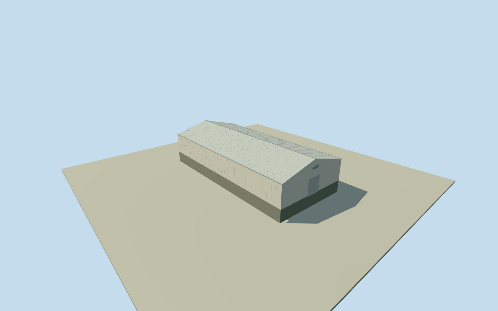

# Daiichi Unit 1 north forecourt hall

Whole independently placed northern low roofed hall in the east forecourt of Unit 1. All four saved contemporary compiled corners, complete exterior walls and closed pitched roof. The two pale roofed halls are visible between the north cylindrical tank and the shore-side works in the already-cleared 1971 aerials. Current-to-historic footprint continuity and assignment of each roof to the current footprint are approximate; no intake/pump/process function asserted. Other hall, tanks, reactor, turbine building and whole plant remain separate. Whole saved compiled feature buildings/35184477917848 with all four numerical controls, separately positioned northern of the paired low roofed halls east of the first turbine building. Contemporary footprint provides approximate registration only. Two cleared circa-1971 DOE aerials show the pair of pale pitched roofs in this forecourt. Exact same-building continuity and individual roof-to-footprint match are unverified; 10 m registration uncertainty. No building name or process function is inferred from compiled generic building tags. Whole four-corner low hall with all exterior walls, complete closed east-west pitched roof and foundation. Pale painted walls and roof follow the two cleared aerials. Wall height 3.4 m above floor and ridge 5 m above floor are estimates with 2 m uncertainty; no mapped height tag exists. Roof pitch, thin sheet joints, gutters, closed end doors and small end vents are conservative original estimates, not a surveyed census. Hidden walls continue plainly; no machinery/interior copied. Original independent 256 m field, 129 x 129 samples, 2 raw tiles, datum 9.2461 m fixed before the floor at .25 m, foundation at -1.65 m, eave at 3.65 m and ridge at 5.25 m. Original corner grades -0.8555 to 0.8277 m. Uneven DEM partly buries the lower wall and exposes the opposite base. Ground/vertical registration approximate; foundation is a closing extension. Field/frame/floor/sections remain fixed, without flattening, masking or refitting. All four LODs retain every original corner, all walls, the full pitched roof, foundation and closed end doors. Skyline omits fine panel seams/vents/gutters; closer levels add seams and simple end ventilation. Individual contemporary-to-1971 identity remains approximate with 10 m registration uncertainty and 5 degree heading uncertainty. Qualla-first imagery: the two exact previously cleared DOE published originals only, with unchanged native hash/provenance proof. No new photograph, questionable source, source-license change or photographic texture. Accepted models remain unchanged. Historical approximate 1971-06-01 preview; current-world eligible false. The neighboring hall, tanks, turbine building, reactor, stack, roads, water and other units are separate. Parent power plant remains unfinished.

Authoring state: **review-in-qa.json**. Current completion evidence is in [qa.json](qa.json) and the [completion ledger](../../../../qualla-structures/batches/qualla-002.PROGRESS.md).

- [Fukushima Daiichi Nuclear Power Plant](https://qualla.com/fukushima-daiichi-nuclear-power-plant/)

Whole independently placed northern low roofed hall in the east forecourt of Unit 1. All four saved contemporary compiled corners, complete exterior walls and closed pitched roof. The two pale roofed halls are visible between the north cylindrical tank and the shore-side works in the already-cleared 1971 aerials. Current-to-historic footprint continuity and assignment of each roof to the current footprint are approximate; no intake/pump/process function asserted. Other hall, tanks, reactor, turbine building and whole plant remain separate.

Whole saved compiled feature buildings/35184477917848 with all four numerical controls, separately positioned northern of the paired low roofed halls east of the first turbine building. Contemporary footprint provides approximate registration only. Two cleared circa-1971 DOE aerials show the pair of pale pitched roofs in this forecourt. Exact same-building continuity and individual roof-to-footprint match are unverified; 10 m registration uncertainty. No building name or process function is inferred from compiled generic building tags.

Whole four-corner low hall with all exterior walls, complete closed east-west pitched roof and foundation. Pale painted walls and roof follow the two cleared aerials. Wall height 3.4 m above floor and ridge 5 m above floor are estimates with 2 m uncertainty; no mapped height tag exists. Roof pitch, thin sheet joints, gutters, closed end doors and small end vents are conservative original estimates, not a surveyed census. Hidden walls continue plainly; no machinery/interior copied.

Original independent 256 m field, 129 x 129 samples, 2 raw tiles, datum 9.2461 m fixed before the floor at .25 m, foundation at -1.65 m, eave at 3.65 m and ridge at 5.25 m. Original corner grades -0.8555 to 0.8277 m. Uneven DEM partly buries the lower wall and exposes the opposite base. Ground/vertical registration approximate; foundation is a closing extension. Field/frame/floor/sections remain fixed, without flattening, masking or refitting.

All four LODs retain every original corner, all walls, the full pitched roof, foundation and closed end doors. Skyline omits fine panel seams/vents/gutters; closer levels add seams and simple end ventilation. Individual contemporary-to-1971 identity remains approximate with 10 m registration uncertainty and 5 degree heading uncertainty.

Qualla-first imagery: the two exact previously cleared DOE published originals only, with unchanged native hash/provenance proof. No new photograph, questionable source, source-license change or photographic texture. Accepted models remain unchanged.

Historical approximate 1971-06-01 preview; current-world eligible false. The neighboring hall, tanks, turbine building, reactor, stack, roads, water and other units are separate. Parent power plant remains unfinished.

Build: `node content/worldgen/source/places/xn/xns/daiichi_unit_1_north_forecourt_hall/models/generate-house.mjs`. Add `--check` to verify exact regeneration. 1694 triangles; 5 materials; no embedded photographs.
