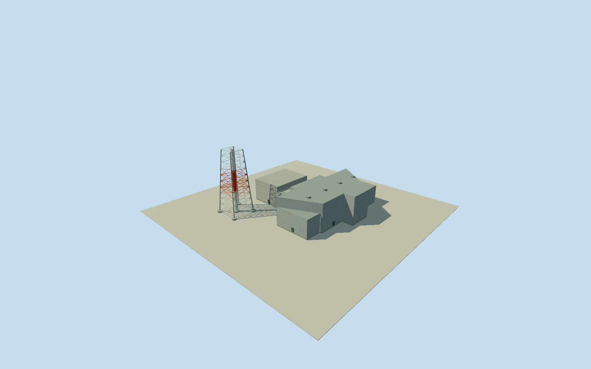

# Daiichi Unit 1 power block

Whole approximate2021 Unit1powerblock: damaged remaining reactor concretebody/operatingdeckOP31,whole original14corner turbinehall withlowattachments and shared1/2stack shortened/cappedat59m. Three separate intrinsicstructures retain their original positions,not a filled compound. Source numerical facts and limited cleared historical QuallaDOEreferenceuse; later continuity and damage/finish estimates explicit.

Authoring state: **review-in-qa.json**. Current completion evidence is in [qa.json](qa.json) and the [completion ledger](../../../../qualla-structures/batches/qualla-002.PROGRESS.md).

- [Fukushima Daiichi Nuclear Power Plant](https://qualla.com/fukushima-daiichi-nuclear-power-plant/)

Whole approximate 2021 Unit 1 power block: remaining postexplosion reactor concrete body and retained operating deck, separately positioned whole 14-corner turbine building and intrinsic shared 1/2 exhaust stack shortened and capped at 59 m. Three independently located structures are kept as separate closed/open meshes inside one bounded unit asset; no filled compound polygon, intact 1971 reactor roof or 120 m later stack. Other units, tanks, unrelated forecourt buildings and plant-wide context remain separate. Qualla first: 25 published image families / zero conflicts. Reuse only the two already cleared DOE circa-1971 originals for limited established relative stack location and broad historic turbine/stack finish. They do not establish a complete 2021 plant appearance. Actual 2012 operator damage/floor levels, original NRC dimensions, 2011 operator turbine dimensions, 2020 operator 59 m cut/cap facts and original 2019 Overture/OSM coordinates control the new representation. All operator/regulator report photos/figures/plans are unused. Exact later damage/repairs, turbine roof subdivisions, paint/brace details, 2021 continuity and vertical ground tie remain explicit estimates. Existing accepted historical models and QA remain unchanged.

Original NRC rounded 42 m square lower / 31 EW x 42 NS upper reactor plans are approximations. Remaining stepped envelope and eastern 11 m shoulder assignment are inferred with 8 m horizontal/plan and 10 m damage/repair uncertainty. Operator 2012 PDF page 3 states damage above fifth-floor OP31.00; OP10.20/18.70/25.90/31.00 are adopted as numerical retained levels, not a detailed later damage survey. No original steel upper roof is restored. Reactor internals/wells/basement and debris microgeometry omitted.

Whole original named 14-corner turbine envelope and inferred 10-control high hall retained. Original operator 2011 section 3.1.1 major rectangle 96.76 NS x 46.90 EW / 25.75 m above grade is a dimensional context, not every projected outer wall. Main roof model26.0 m carries .25 m first-floor offset; low attached roofs estimated16.9 m with6 m uncertainty. Four roof vents, panel joints, closed doors and roof section/finish are estimated2 m, not an observed 2021 facade census.

Original operator May2020 report states120m to59m dismantling completed29April2020, cap installed1May2020. New stack is59 m and capped, not an intact120 m pipe. Original2017 22m base /5.4m width at111m,3.2m bore and4.6m piers give estimated remaining linear taper; exact cut members, cap finish, brace/paint boundaries, ladder/platform and ground exposure estimated2 m. Existing stack point/axis reused from accepted cleared1971photographic registration,25 m position/15degree facing uncertainty.

All three structures share a nominal OP10 site-level assumption but the absolute historic vertical tie is unverified. Own512m129x129field16641values/4rawtiles/datum11.4928m frozen before floors/sections. No mask, flattening, grade fitting, frame change or later main-section adjustment. Composite DEM may include vegetation/building/cliff returns and bury footings; record actual field appearance.

Nominal2021-03-11 phase has unverified continuity/repairs and is not current-eligible. Two already cleared published Qualla DOE1971 originals are used only for established relative stack location and broad historic appearance context; they do not show coherent2021architecture. Operator/regulator report photos, figures, plans and satellite/map pixels unused. Existing accepted assets, fields, frames, floors and QA unchanged. Whole six-unit plant remains separate.

Build: `node content/worldgen/source/places/xn/xns/daiichi_unit_1_power_block/models/generate-house.mjs`. Add `--check` to verify exact regeneration. 6504 triangles; 6 materials; no embedded photographs.
