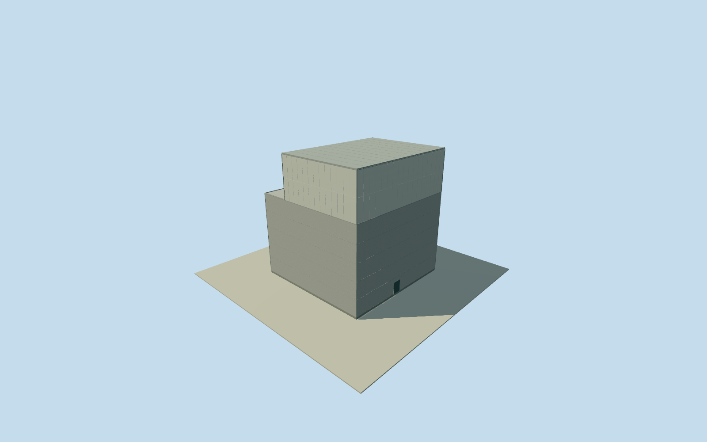

# Daiichi Unit 1 reactor building

Whole intact circa1971 Unit1reactor building:42x42m concrete lowersection/42x31m whiteclad steelupperhall/fullclosedroof/steppedshoulder. Original primary58m mat-based height minus14m embedment gives44m exterior; originalroof/finish fromclearDOEphotos. Adjacent turbine/radwaste/stack separate.

Authoring state: **review-in-qa.json**. Current completion evidence is in [qa.json](qa.json) and the [completion ledger](../../../../qualla-structures/batches/qualla-002.PROGRESS.md).

- [Fukushima Daiichi Nuclear Power Plant](https://qualla.com/fukushima-daiichi-nuclear-power-plant/)

Whole independent FukushimaDaiichi Unit1 reactor building in approximate1971 intact phase:42x42m lower concretebody,42x31m upper steel-clad hall, full closed shallow roof, stepped shoulder, estimated facadepanels/closed serviceentries. Structurally separate turbine/radwastebuildings, stack and otherunits are separate; parentwholeplant remains unfinished. No internal reactor/containment machinery, current damaged/decommissioningcover or land/siteextrusion.

Original NRC/Argonne1985NUREGCR4432 section2 pp2–3 identifies actual460MWeUnit1 completed1970/operating1971 and lower42x42m/upper42x31m sections. Authored42m square is those written dimensions, NOT the contemporary compiled54x48m observation envelope. Cleared oppositeaerial1971views and coast/switchyard/turbine relationship locate firstcompleted northernreactor of Units1–4. Compiled footprint35185004080619 supplies approximateposition only; original tags unavailable429 and no historicalfootprint claimed. Heading0 follows sourceNS/EW convention,3degree uncertainty; originalupper31mEW/42mNSorientation and setback side estimated.

Original NRC/Argonne1985NUREGCR4432 section2 printedpp2–3 supplies lower42x42m/upper42x31m,58m fromfoundationbase,14m embedded,43mconcretefrombase. Derived abovegradeheight44m and concrete29m are approximate originalnumericfacts; steelupperhall15m. No58m aboveground or containment-dome substitute. Buried14mfoundation/interior reactorcontainment omitted from exteriorasset.

Upper31mEW/42mNSorientation/eastflush-west11msetback is an explicit interpretation from two cleared opposite aerialviews and approximateNS/EW convention, not originaldimensionedplan.3degreeheading/8mhorizontalregistration uncertainty. Currentcompiled54x48m observation may include latercover; not extruded as1971building.

Originalphoto date circa1971; represented1971-06-01 is approximate scheduling date, not exact captureday. Current2026mapcontext is only approximateanchor; historic corners not surveyed. Closedpreaccidentroof/whitecladding retained; no2011damage/moderndecommissioningcover or currentappearance claim.

Facadepaneljoints/closedserviceentries/frame/shoulderparapet/flatroofdrainage/finish and hiddenlowerwall details estimated2m. Architecturalblankness followscleared unit1 upperhall; dense grid on adjacentunit2construction is not copied. Turbinehall/radwastebuildings/stack/siteinfrastructure/otherunits separate; wholeplant unfinished.

Original256m129x129field/16641heights/4rawtiles/datum15.2558m fixed BEFORE floor.25/foundation-.6..+.25/concrete29.25/upperroof44.25m. Originalhistoricgrounddatumnotavailable; compositeDEM may contain hill/building/cliff returns. Neverflatten/mask/refetch/reframe/refit sourcefield/floor/mainsections. Qualla-first25families/zero conflicts; two alreadycleared publishedDOEgovernmentworkoriginals; every NRC diagram/photo unused.

Build: `node content/worldgen/source/places/xn/xns/daiichi_unit_1_reactor_building/models/generate-house.mjs`. Add `--check` to verify exact regeneration. 1468 triangles; 5 materials; no embedded photographs.
