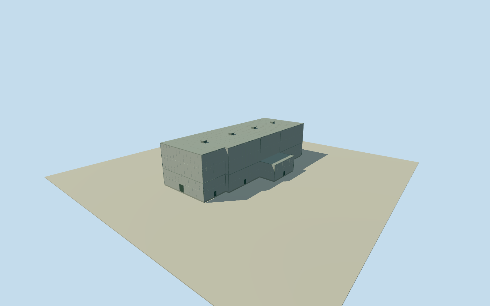

# Daiichi Unit 1 turbine building

Wholecirca1971Unit1turbinebuilding: all14originalcompiledoutercontrols, longhighlightcladmainhall/fullflatgrayroof/lowerintrinsicprojections/roofvents andclosedserviceentries. Historicoutlinecontinuity/heights/details explicitly estimated; reactor/otherunits separate.

Authoring state: **review-in-qa.json**. Current completion evidence is in [qa.json](qa.json) and the [completion ledger](../../../../qualla-structures/batches/qualla-002.PROGRESS.md).

- [Fukushima Daiichi Nuclear Power Plant](https://qualla.com/fukushima-daiichi-nuclear-power-plant/)

Whole independently positioned circa1971 Unit1turbinebuilding: all14 compiledhorizontalcontrols/complete longmainhall/fullclosedroof, intrinsic lower west/eastserviceprojections, lightpanelwalls/estimatedclosedserviceentries and fourroofventhousings. Currenttohistoricfootprint continuity/height/detailcounts approximate. Reactorbuilding/radwaste/stack/tanks/pumpstation/Unit2construction and wholeplant remain separate.

Whole contemporarycompiledbuilding35184477917842 (encodedOSMway105829010, rawwaytags unavailable) directlyeastof the firstcompletedUnit1reactor. All14originalnumericaloutercontrols and intrinsicwest/eastprojection retained. Two alreadyclearedoppositeDOEcirca1971aerials establish longlightclad turbinehall/flat grayroof/lowserviceparts in this position. Current2026footprint projected into1971appearance is an explicitestimate,8m registration/3degreeaxis uncertainty. Main10cornerhighhall and two lowerprojections are originalgeometricinterpretations, not surveyedheightparts. Otherunits/siteparcel not filled.

All14originalcompiledoutercontrols retained, no wholecomplexrectangle/siteparcel extrusion. Main10control higherhall selects originalindices0/1/4/5/6/7/10/11/12/13; west/eastprojections lower. Verticaltier interpretation and exact1971cornercontinuity are explicit estimates; not originaltaggedbuildingparts or historic survey.

Mainroof25m/lowserviceparts10m above floor estimated from two originalaerials relative to knownUnit1reactorheight,5m mainheight uncertainty/3m lowerheight uncertainty. Every facadepanel/door/window/vent/cap/roofjoint dimension and fourroofvent positions/count approximate2m. No currentpaint/camo/damagecover or unseeninternalmachinery invented.

Wholelightcladlonghall/fullflatgrayroof/lowattachedservicevolume as clearedoriginals; hiddenrear/obscuredlowerwalls conservative continuations. No Unit2construction/turbinehall, reactorbody, separateradwaste/tanks/stack/pumpstation/roads/cliff/water proxy. Parentfullplant unfinished.

Originalreference circa1971; represented1971-06-01 approximatephase only. Current2026compiledsource positionaluncertainty8m/3degreeorientation; exactoldnativewaytags unavailable429. Currentmappedoutline retainedasnumericalcontrol withhistoriccontinuitylimited; photographcoordinates notsurveyed.

Original256m129x129field/16641heights/2tiles/datum12.1098m fixed BEFORE floor.25/foundation-.6..+.25/mainroof25.25/lowerroof10.25m. Historicabsolutegrade/verticaltie unavailable; sourcefield may include latercliff/building/canopyreturns. Do notflatten/mask/refetch/reframe/refit. Qualla-first25families/zeroconflicts, same two alreadyclearedDOEoriginals; no newphotographs or phototextures.

Build: `node content/worldgen/source/places/xn/xns/daiichi_unit_1_turbine_building/models/generate-house.mjs`. Add `--check` to verify exact regeneration. 4166 triangles; 4 materials; no embedded photographs.
