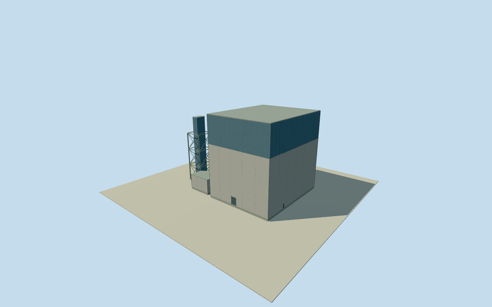

# Daiichi Unit 2 reactor building

WholeUnit2exteriorreactor,14nativeenvelopepoints,primaryroof45.72mabovegrade/floorrelative45.52m,operatingfloorandwest10mroomat30m/openbracedgantry/stairaccess/lowserviceprojection. Nativepartinterpretation/finish/details/2019continuityestimated,allappearanceimagesunused. Notinternalcontainmentorwholeplant.

Authoring state: **review-in-qa.json**. Current completion evidence is in [qa.json](qa.json) and the [completion ledger](../../../../qualla-structures/batches/qualla-002.PROGRESS.md).

- [Fukushima Daiichi Nuclear Power Plant](https://qualla.com/fukushima-daiichi-nuclear-power-plant/)

Whole independent Unit2reactorbuilding exterior with its intrinsic westaccesschamber/supportgantry/stairaccess andlowserviceprojection, representednominal2019. All14originalnativeenvelopepoints atfullnativebase, completefourcornermainhall/fullclosedroof. This is exterior reactorbuilding, not the internalsteelcontainmentvessel named loosely in mapdata. Otherunits/turbine/wholeplant remain separate. Allappearanceimagesunused; currentQualla-first25families/0conflicts. OriginalregulatorNRA039003856-002-002/TEPCO10October2017 numericallabels establishroofOP55.72m/groundOP10m=45.72m abovegrade andoperatingfloorOP39.92m=29.92m abovegrade,61.78mfrommatnotabovegrade. Sourcewrittenoperator26June2017westchambersteel/steelroofwall10mhighx16mEWx22mNS,openingbottom~30mabovegrade. OriginalOSM/Overture2019updated14corneroutlineincludeswestappendagesbutnotheightparts. Wholemainhall/room/support/stairtower andlowerprojection boundaries are explicitinterpretationsofnativecorners, not observed roofpart polygons; mainhorizontal8m/part2m/estimatedserviceroof3m uncertainties. No2011explodedroof or1971Unit1appearance transplanted. Nominal2019continuity, paint,finishes,frames/closedentries/roofdrainage andhiddenwalls approximate; currentWorldEligiblefalse. Everyreportfigure/plan/photo/map/satelliteimageunused; onlywritten/numericaltext extracted.

Originalregulator10October2017 numericaltextlabels(PDFpage59) roofOP55.72,groundOP10.00,1F10.20,5F39.92,matbottom-6.06m. Derivedroofabovegrade45.72m,rooffromfirstfloor45.52m,operatingfloorfromfirstfloor29.72m,overallmatroof61.78m. Mainroof45.77/floor.25 retains45.52mfirstfloorheight; originalfirstfloor.2m abovegrade differsfromchosen.25mby.05m, grade/verticaltie approximate. Never61.78mabovegrade nor33msteelcontainment exterior substituted.

Originaloperator26June2017writtenappendix9(PDFpage13) westaccesschambersteelconstruction/steelroofandwall10mhigh/16mEW/22mNS; bottomopeningabout30mabovegrade. Actualnativewestroomspanabout17x23m preservedasfullnativeprojectioninterpretation,2mcomponentuncertainty; thisisnot currenttour30x38x16wholegantrydimension. Suspendedroom30.25..40.25m andopenbracedsteelgantrybelow, closedestimatedstairsinsidewestenvelope, smallsouthwesternserviceblock8.25m. Stair/beamcensus/sectionpartition/lowserviceheight/finefinishnotobserved;3m lowserviceheightuncertainty. No falsefilled40mwestboxdownfromroof.

All14originalnativeoutlinecorners retainedatfullfoundationenvelope; eastfourcornerclosedmainbody,westroomandopenunderstructure,stairenvelopeandlowserviceprojectionoriginalinterpretations. Nativewholeenvelopeisnotexactroofpart/floorcensus,8mhorizontal/3degreeheadinguncertainty. Blanklightconcretebody,mutedblueestimateduppersteelcladding,grayclosedroof/paneljoints/closedlargepanel/door/drainage detailsestimated2m. No actualindustrialinternalplant/equipmentorreactorcontainmentmodeled.

Original own256m129x129field16641values/4rawtiles/datum18.1399m frozenbeforefloor.25/foundation-1.2/mainconcretetop29.97/mainroof45.77/chamber30.25..40.25/serviceroof8.25. Fieldcancontainbuilding/cliffreturns; originalsitegroundcontactunverified. No masking/flattening/refitting/reframing field/frame/floor/mainsectionsforanyrender.

Nominal2019-11-09preview uses2019updatednativeoutlineand2017operator/regulatorfacts; temporalcontinuityandfineappearanceunverified,currenteligiblefalse. Existingaccepted1971Unit1membersandcompleted2019Unit2turbinepreserved. Wholeplantunfinished. Allappearanceimageryunused,Qualla-first25families/0conflicts; no reportfigure/plan/photo/map/satelliteimageviewed/copied, numericlabelsandwrittentextonly.

Build: `node content/worldgen/source/places/xn/xns/daiichi_unit_2_reactor_building/models/generate-house.mjs`. Add `--check` to verify exact regeneration. 3214 triangles; 5 materials; no embedded photographs.
