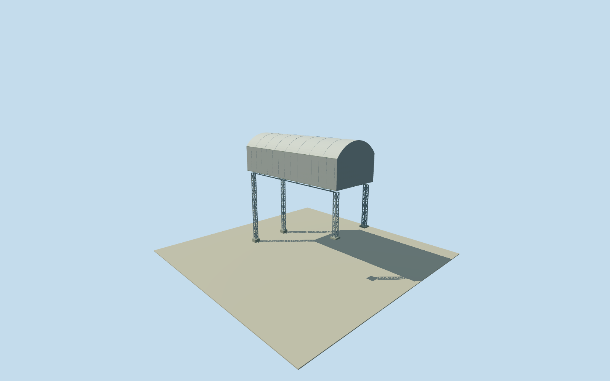

# Daiichi Unit 3 fuel removal cover

Whole independent Unit 3 fuel-removal steel dome cover and portal-truss frame. Original written57mEW/22.8mNS/53.5m crown,47.6m eaves,36m workfloor. Four bearing blocks at estimated west1F/east3F support levels; underlying damaged reactor remains separate. Circular roof interpolation, portal details/finish and nominal2019continuity estimated. All appearance imagery unused.

Authoring state: **review-in-qa.json**. Current completion evidence is in [qa.json](qa.json) and the [completion ledger](../../../../qualla-structures/batches/qualla-002.PROGRESS.md).

- [Fukushima Daiichi Nuclear Power Plant](https://qualla.com/fukushima-daiichi-nuclear-power-plant/)

Whole independent Unit3 fuel-removal cover: written57mEW x22.8mNS steel-clad dome/portal-truss structure,53.5m crown,47.6m eaves,36m workfloor, western/eastern support frames and concrete bearing blocks. Underlying damaged reactor, its floors/interiors and whole plant remain separate/unfinished. All appearance imagery unused. Qualla-first25families/0conflicts; cleared1971DOE imagery predates this cover and is not applied. Original operator structural submission archived by NRA2013: written steel truss/dome, steel folded cladding,57x22.8x53.5m. Numerical eave47.60/crown53.50/workfloor36.0 and original bearing OP10.500/26.900 retained; gradeOP10 inferred from original crownOP63.50 minus53.50m abovegrade; ground tie explicitly approximate. Source native13corner Unit3 envelope is context only; cover centred on southern west-projecting corridor with8m registration/3degree heading uncertainty. Roof profile uses circular segment matching written width/eave/crown, not observed curvature; portal leg count/locations/sections, bracing/joints/end panels, hidden details/neutral metal finish estimated2m. Eastern bearing blocks at16.9m require host reactor3F support, omitted in standalone cover. Nominal2019-11-08 native context/2013design/2018operation continuity unverified,currenteligiblefalse. No report figure/plan/photo/map/satellite pixels used.

Original NRA archived operator2013submission PDF4 written57.0mEW/22.8mNS/53.5mhigh steel folded cladding; PDF7 written lightweight steel truss portal/dome roof and concrete bearing blocks at reactor1F/3F. PDF36 written eaves47.60m/crown53.50m. Numeric PDF4 workfloor36m/roofrise17.5m,PDF30OP10.500/31OP26.900/32girderOP46.000/37crownOP63.50. GradeOP10 inferred from crown elevation-minus-height, not surveyed host terrain. West/east assignment of low/high bearing blocks inferred from native corridor/turbine context, not viewed plan.

Complete57x22.8m upper cover, workfloor36, eave47.6, crown53.5. Circular-segment roof profile between width/eave/crown controls is an estimate, not actual measured curvature. Western/eastern portal trusses,4support towers at x+/-26.6,z+/-9.25,westbearing.5/eastbearing16.9,portal sections/bracing counts/roof joints/hidden details/gray metal finish estimated2m. Original operating-floor label OP26.900 in PDF31 caption5F is internally inconsistent and NOT adopted as5F; only3F bearing26.900 used.

Underlying damaged reactor and its1F/3F/5F floors/interiors are separate and unfinished. Eastern bearing blocks deliberately elevated16.9m require the host reactor thirdfloor support; no invented ground-reaching support below. Standalone cover is not a complete reactor/plant proxy. Full native13corner reactor envelope only registers written cover approximately. Written57x22.8m cover centred on southern west-projecting source corridor; part correspondence8m/heading3degree uncertainty.

Own original256m129x129 field16641 values/2rawtiles/datum14.0067m acquired BEFORE westbearing.5/eastbearing16.9/workfloor36/eave47.6/crown53.5/supportsections. No source field/frame/floor/main-section mask, flatten, refit or reframe. CompositeDEM may contain building returns; actual historic grade and vertical registration unverified.

All appearance imagery unused; Qualla-first25families/0conflicts,1971clearedDOE imagery predates this cover. Every report figure, plan, photo, map/satellite pixel unused; original written/numerical facts and ODbL coordinates only. Nominal2019-11-08native context plus2013design/2018operation temporal continuity estimated, currentWorldEligiblefalse.

Build: `node content/worldgen/source/places/xn/xns/daiichi_unit_3_fuel_removal_cover/models/generate-house.mjs`. Add `--check` to verify exact regeneration. 7546 triangles; 4 materials; no embedded photographs.
