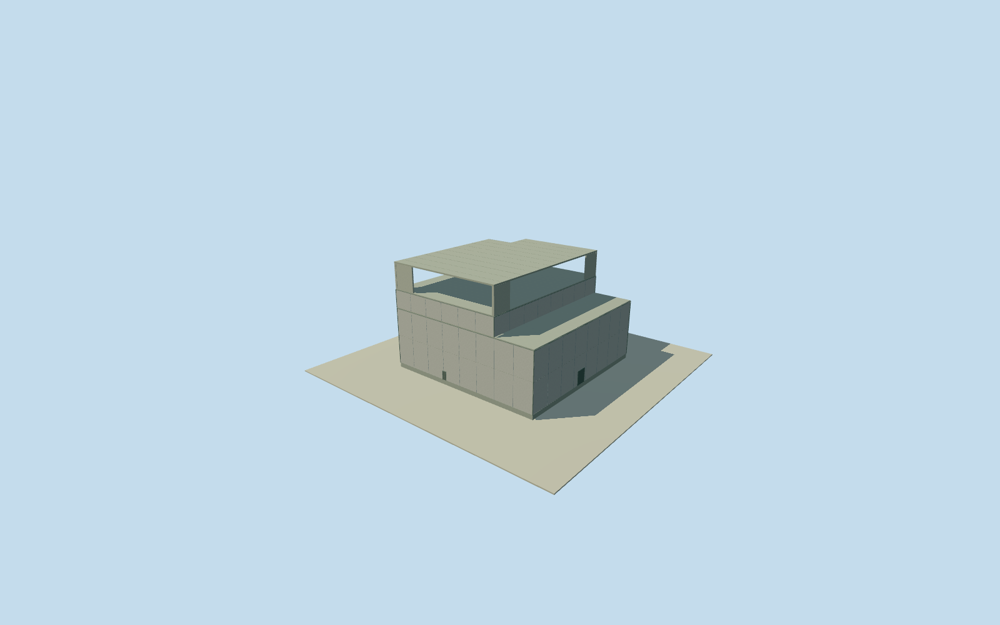

# Daiichi Unit 3 reactor building

Whole remaining Unit3reactor concrete body: written47m square lowerfloors/35.2EWx47NS upperbody/eastern terrace, exposed operating deck atOP39.92 after lost roof. Open damaged4Fframe/sixestimatedconcretecolumns/fourwallfragments/northwest9x8mdeckloss are coarse10m damage estimates. Original steel roof/internalcontainment/basement/separate accepted dome cover omitted. All imageryunused; primarytext facts/2019continuity/registration bounded.

Authoring state: **review-in-qa.json**. Current completion evidence is in [qa.json](qa.json) and the [completion ledger](../../../../qualla-structures/batches/qualla-002.PROGRESS.md).

- [Fukushima Daiichi Nuclear Power Plant](https://qualla.com/fukushima-daiichi-nuclear-power-plant/)

Whole remaining Unit3 reactor concrete exterior after loss of original upper roof: written47x47m lower floors1/2 and35.2EWx47NS upper floors3/4,operating deckOP39.92. Lower east terrace, remaining upper slab/columns/wall fragments and approximate northwest deck loss included. Separate already-completed fuel-removal dome cover/its frame, internal containment, basement and whole plant are excluded. All appearance imagery unused; Qualla-first25families/0conflicts,1971clearedDOE imagery predates completed Unit3 and is not applied. Original written horizontal dimensions retained from public search-extracted original operator report facts, honestly labelled extracted-cache record, not originalPDFbytes. Original operator2012postdamage report describes loss above5F,northwest5Ffloor loss and substantial4Fwall damage. Original2013remaining-building table retains1FOP10.20/2F18.70/3F26.90/4F32.30/5F39.92. No intact original45.72m roof rebuilt. Exact later repair/scar extents unknown: open4Fframe/northwest9x8mdeck notch/four residualwall strips/six upper columns are coarse10m damage-envelope estimates,not measured damage map or column census. Finefinish/doors/paneljoints estimated2m. Original13point envelope only provides approximate registration; written lowerwestflushupper/east11.8mterrace inferred,8mhorizontal/3degreeheading uncertainty. Nominal2019-11-08native context/2012-13postdamage continuity unverified,currenteligiblefalse. Every reportfigure/plan/photo/map/satellitepixelunused. Accepted cover asset remains unchanged and is not duplicate completion credit.

Original operator written dimensions retained as explicitly labelled web-search-extracted facts record, not original PDF bytes: lowerfloors1/2 47NSx47EW,upperfloors3/4/5 47NSx35.2EW,basement47NSx57.4EW,originalabovegrade45.72m/frommat61.78m. Original45.72mroof is NOT modeled after2011loss. No report figure/plan/photo used.

Original2012operator postdamage PDF7 says above5F destroyed,northwest5Ffloor damaged and substantial4Fwall loss; original2013operator remaining-building table/paragraph records5FOP39.92/4F32.30/3F26.90/2F18.70/1F10.20. SiteOP10 from original2013cover crownOP63.50minus53.50abovegrade. Model floor.25 instead of nominal.20 gives explicit.05m grade offset: thirdfloor16.95/fourthfloor22.35/operatingdeck29.97. These are exposed slabs, not a restored original steel roof.

Postdamage exterior reconstructed coarsely: whole47m lowerbody/east11.8m terrace,35.2m upperbody to4F,remaining5Fdeck with estimated northwest9x8m notch,open4Fframe/sixestimated.65m concrete columns/fourshort remainingwall strips. Exact scars, later repairs, column census and survivingwall locations unknown;10m damage-envelope uncertainty. Floor slabs.4m/remainingwall thickness.4m/doors2/paneljoints/neutralconcrete finish estimated2m. No rubble pile/currentconstruction census claimed.

Native original13point Unit3 envelope includes cover/service parts; writtenlower/uppergeometry is NOT a native ground polygon. Upperwidth anchored to original northern roof observations6/4/3/7; bodyNScentre uses6/10 extents. Lowerwestflushupper/eastterrace interpretation inferred.8m horizontal/3degree heading/3m height uncertainty. Accepted independent dome cover/its supports unchanged, omitted from this body and not duplicate credit.

Own original256m129x129field16641values/2rawtiles/datum14m fixed BEFORE floor.25/foundation-1.2/lower16.95/fourth22.35/deck29.97/upperdamage sections. No source field/frame/floor/mainsections mask, flatten, refit or reframe. CompositeDEM may include adjacentbuildingreturns; actual historicground/vertical tie unverified.

Nominal2019-11-08native context with2012/2013damage/designtext has unverified temporal continuity; currentWorldEligiblefalse. Every appearanceimage/reportfigure/plan/photo/map/satellitepixelunused. Qualla-first25families/0conflicts;1971clearedDOE originals predate completedUnit3 and notapplied. Basement/internalcontainment/domecover/otherbuildings/wholeplant remain separate.

Build: `node content/worldgen/source/places/xn/xns/daiichi_unit_3_reactor_lower_building/models/generate-house.mjs`. Add `--check` to verify exact regeneration. 1272 triangles; 4 materials; no embedded photographs.
