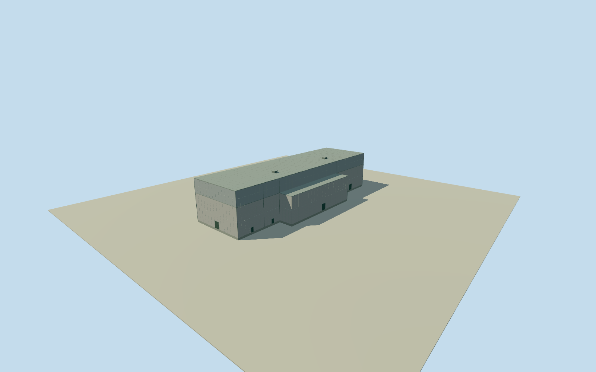

# Daiichi Unit 3 turbine hall

Whole independent Unit3 turbine hall: all9fullnativecorners, operator25.75m maximumheightassignedwith3muncertainty, concretebody/steelupperhall/fullclosedroofs/lowerattachedservices/closedentries and2estimatedroofvents. Highhallpartition/finefinish/2019continuity explicit estimates; no appearance images used; westernancillaryengineeringextent/reactor and otherunits separateandunfinished.

Authoring state: **review-in-qa.json**. Current completion evidence is in [qa.json](qa.json) and the [completion ledger](../../../../qualla-structures/batches/qualla-002.PROGRESS.md).

- [Fukushima Daiichi Nuclear Power Plant](https://qualla.com/fukushima-daiichi-nuclear-power-plant/)

Whole separately mapped nine-corner Unit3 turbine-hall roofed body, complete high mainhall and intrinsic lower eastern projection, all walls and closed roofs. Operator full engineering turbinebuilding has additional western ancillary extent beyond this distinct mapped body; that extent, reactor, other units and whole plant remain separate and unfinished. All appearance imagery unused. Qualla-first25families/0conflicts contain cleared DOEcirca1971images showing Unit3duringearlyconstruction, not its completed2019exterior; these images are not applied to this body. Original TEPCO17August2011written section3.3.1 gives127.15m NS by67.60m EW mainplan,37.35m from foundation and25.75m abovegrade,3aboveground/1basementfloors,reinforcedconcrete/steeltrussroof. Full original native2019updated9corneroutline retained; originalmap record has no heights/roofshape/facade. Nominal2019preview combines that outline with2011dimensions; temporal continuity remains unverified. Fulloperator127.15x67.60mplanisnotclaimedastheareaofthisnarrowermappedhallbody. Maximum25.75mheightassignedtomainhallwith3muncertainty. Highhallplan,lower16.9m service tiers,flatroof,lightgrayfinish,closedentries and smallroofvents are estimates, not observed facadecensus. No photographs/satellite/map images/report figures/plans or phototextures used.

Operator original17August2011report printedpage3-23/PDFpage27 section3.3.1 specifically FukushimaDaiichiUnit3turbinebuilding: mainplan127.15mNS/67.60mEW,abovegroundheight25.75m versus37.35mfrommatbottom,3storeysabove/1below;reinforcedconcretewithsteeltrussroof. Buildingisstructurallyseparatefromreactor. Never37.35maboveground or internalreactorcontainment substitute. Basement/internalturbineequipment omitted from exterior.

All9fullnativeOSM/Overtureoutlinecorners retained. Originaloperatorfull127.15x67.60mengineeringplanincludeswesternancillaryextentnotinthisnarrowermappedbody, which remainsunmodeledandunfinished. Maximum25.75mabovegradeheightassignedtohighhallwith3muncertainty;notaseparatesurvey. Nativebodyincludeseasternlowprojection; highhallsevennativecornersindices0/1/2/3/6/7/8 and16.9mlowerroof estimated from footprint offsets and numericalthirdfloorlevelOP26.90minusOP10sitelevel; the source doesnot state this actualroof-tierpartition. Flatgrayroof/lightgrayconcretewalls/cladupperhall,2roofventcentres,sizeandcount,closedserviceentries,paneljoints,rainpipes andhiddenfinishes estimated2m;3m tier-height/8m horizontal/3degree heading uncertainty. No observed facadecensus, no copy of1971Unit1 facade.

Original own256m129x129field16641values/1tiles/datum11m acquired beforefloor.25,foundation-1.2,lowerroof17.15/mainroof26.00m. Nativeframe,sourcefield,floorandmainsectionsfrozen unchanged; no flatten/mask/refit/reframe to improve any image. Grade/verticaltieapproximate, no2019groundsurvey. Compositefieldcancontainbuilding/cliffreturns.

Nominal2019-11-09preview uses2019updatednativeoutlineand2011writtenengineeringdimensions; exact2019continuity/roofdetailsunverified,currentWorldEligiblefalse. Otherunits/reactor,wholeplant,nearbybuildings/siteyard notmodeledbythismember. Allappearanceimageryunused, Qualla-first25families/0conflicts. ExistingclearedDOE1971referencesdescribeincompleteUnit3andnotused. Everyreportfigure/plan/photo/map/satelliteimageunused. No separatefinalization/reopeningacceptedmodels.

Build: `node content/worldgen/source/places/xn/xns/daiichi_unit_3_turbine_hall/models/generate-house.mjs`. Add `--check` to verify exact regeneration. 4297 triangles; 5 materials; no embedded photographs.
