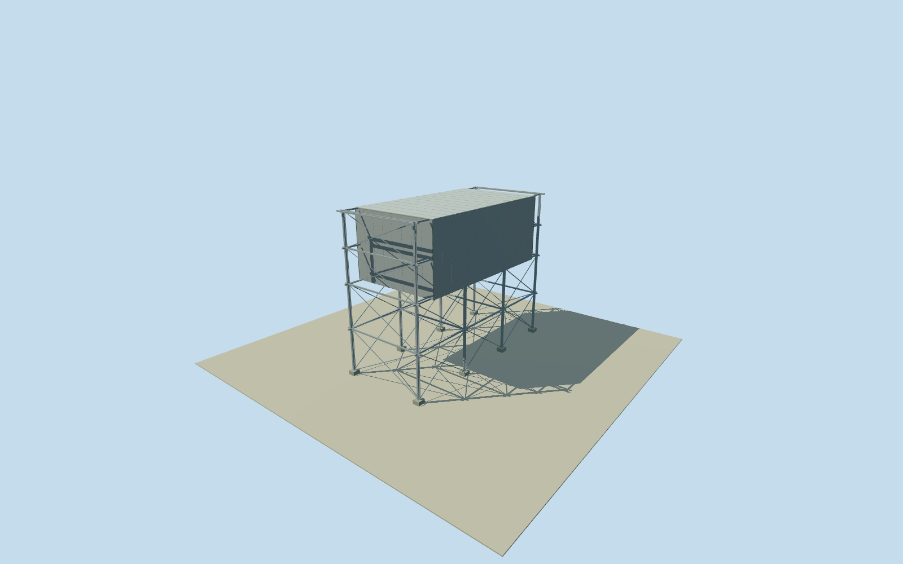

# Daiichi Unit 4 fuel removal cover

Whole independent Unit4steel fuel-removal cover frame: written69mNS/31mEW/53mhigh,55mNSx31mEWx23m upper working enclosure above inferred30m operating floor. Open lower/end bays,8estimated steel columns/ground bearings,longitudinal and cross beams/bracing,closed upper walls/roof/floor. Native context identity/registration, enclosure position, fine sections/finish/2021continuity estimated. Underlying reactor remains separate. All imagery unused.

Authoring state: **review-in-qa.json**. Current completion evidence is in [qa.json](qa.json) and the [completion ledger](../../../../qualla-structures/batches/qualla-002.PROGRESS.md).

- [Fukushima Daiichi Nuclear Power Plant](https://qualla.com/fukushima-daiichi-nuclear-power-plant/)

Whole independent Unit4 fuel-removal steel cover frame: written69mNSx31mEWx53mabovegrade, upper working enclosure55mNSx31mEWx23m high above nominal30m operatingfloor; open lower frame, exterior end bays, full roof/sidewalls/endwalls, ground bearing blocks. Underlying damaged reactor/internal equipment and whole plant remain separate/unfinished. All appearance imagery unused. Qualla-first25families/0conflicts;1971clearedDOE photographs predate this cover and are not applied. Original2017operator written Unit4cover69NSx31EWx53high and working55NSx31EWx23aboveoperatingfloor;30m operatingfloor inferred53minus23. Original2013operator written comparison distinguishes Unit4large steel column/beam structure and independent ground foundations from Unit3lightweighttrusses. Native14point unnamed envelope Unit4 identity inferred from west-of-Unit4-turbine/south-of-explicit-Unit3 sequence. Southern9pointcontext~35x71m approximate registration only,not literal cover ground corners. Upper55m enclosure centred along69m frame,8column positions/Hsections/beam and brace levels/openendbay lengths,roof finish/closed panel joints/groundbase estimated2m; source part registration8m/heading3degree uncertainty. Nominal2021-03-11native context/2017written design temporal continuity unverified,currenteligiblefalse. Every report figure, plan, photo, map/satellite pixel unused.

Original2017operator written Unit4 cover69mNSx31mEWx53mabovegrade,working enclosure55mNSx31mEWx23m aboveoperatingfloor. Operatingfloor30m inferred53minus23, not a surveyed OP level. Original2013operator comparison distinguishes Unit4large steel column-and-beam frame/independent ground foundations from Unit3light truss cover.

Whole69x31m steel frame includes8estimated Hcolumns/two rows/fourNSstations,spanning longitudinal/cross beams/open lower frame/open7m end bays,55x31x23m upper working enclosure with closed walls/roof/floor. Upper enclosure centred along69m frame is an estimate with7m longitudinal placement uncertainty; flat roof/panel joints/hidden surfaces/neutral gray finish/column sections/bracing/beam levels/foundation blocks estimated2m. No crane/containment/internal reactor invented.

Original unnamed14point envelope identity inferred as Unit4 by south-of-explicit-Unit3/west-of-Unit4-turbine context; turbine4 identity also inferred from neighbouring namedThirdturbine sequence. Source southern9point~35x71m context provides approximate centre only. Written31x69m is NOT a native ground footprint or source roof-part survey;8m horizontal/3degree heading/3m height uncertainty.

Own original256m129x129field16641values/2rawtiles/datum15.2835m fixed BEFORE floor.25/foundation-1.2/operating30/mainroof53/column and beam sections. No field/frame/floor/main-section mask, flatten, refit or reframe. CompositeDEM may contain adjacent building returns; actual historic grade/vertical tie unverified.

Underlying damaged Unit4 reactor and its floors/interiors remain separate and unfinished; this cover does not complete reactor or plant. Nominal2021-03-11nativecontext/2017written design temporal continuity unverified,currentWorldEligiblefalse. All appearance imagery unused,Qualla-first25families/0conflicts;1971clearedDOE imagery predates cover. Every report figure/plan/photo/map/satellite pixel unused.

Build: `node content/worldgen/source/places/xn/xns/daiichi_unit_4_fuel_removal_cover/models/generate-house.mjs`. Add `--check` to verify exact regeneration. 1944 triangles; 4 materials; no embedded photographs.
