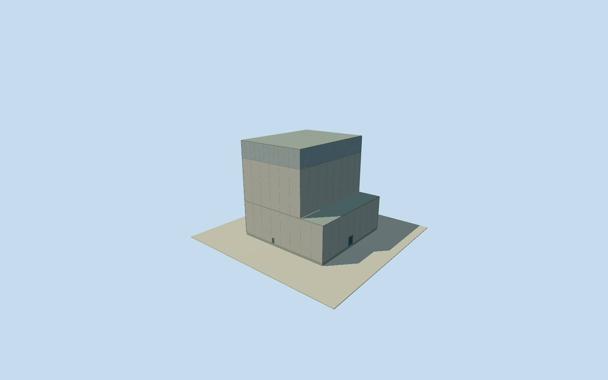

# Daiichi Unit 5 reactor building

Whole Unit 5 aboveground reactor: operator-written 47m square lower body, 35.2m east-west by 47m north-south upper body, 46.05m abovegrade height. East lower terrace, concrete walls, closed roofs and entries. Native four-corner record registers upper roof only; lower outline is written dimensions. Finish, terrain tie and 2021 continuity estimated; appearance imagery unused.

Authoring state: **review-in-qa.json**. Current completion evidence is in [qa.json](qa.json) and the [completion ledger](../../../../qualla-structures/batches/qualla-002.PROGRESS.md).

- [Fukushima Daiichi Nuclear Power Plant](https://qualla.com/fukushima-daiichi-nuclear-power-plant/)

WholeUnit5reactorbuildingexteriorfromoriginaloperatorwritten47x47mlowerfloors1/2and35.2x47mupperfloors3/4/5with46.05mabovegradeheight. Intrinsiceastlowerroofterrace11.8mwideincluded;native4cornerrecordprovidesupperroofapproximateanchoronly,notcompletegroundbody. Basement/internalcontainment/adjacentturbine/wholeplantremainseparate. Allappearanceimagesunused,Qualla-first25families/0conflicts;cleared1971DOEoriginalspredatecompletedUnit5andnotapplied. Operator17August2011section3.1printed3-1/PDFpage5explicitwholeabovegroundlower47x47m/upper47mNSx35.20mEW/height46.05mabovegradevs62.11mfrommat/5aboveand1belowfloors/reinforcedconcreteandsteeltrussroof. NumericOP13.20firstfloor/29.90thirdfloor/42.92operatingfloor/50.82cranelevel/59.05roof;groundOP13. Underground47x57.4mextentomitted. NativeUnit5fourcornersmatchupperroofapproximately37.5x47.6m,notcomplete47mlowerfootprint. Writtenuppercenteranchoredtooriginalroofmidpoint;lowerwestflushupper/east11.8mterraceinterpretationinferredfromoriginaladjacentturbinewesternsharedprojectionandmatching16.9mlevel,notviewedplan/photo. Engineeringownershipofmaproofsegmentationunverified;existingcompletedturbineuntouched,sharedterracenotadditionalcompletioncredit. 8mhorizontal/3degreeheading/3mheight/2mcomponentuncertainty,nominal2021-05-09nativeupdate/2011engineeringcontinuityunverified,currenteligiblefalse. Finefinish/roofpartdetails/closedentries/panelsestimated. Everyreportfigure/plan/photo/map/satelliteimageunused.

Originaloperator2011section3.1printed3-1/PDFpage5specifies47x47mlowerfloors1/2,47mNSx35.2mEWupperfloors3/4/5,46.05mabovegrade/62.11mfrommat,5aboveand1belowfloors,RCbodyandsteeltrussroof. Larger47x57.4mundergroundfoundationomitted. Wholeabovegroundbodyiswrittencontrols,notthefourpointupperroofobservationextrudedasentirebuilding.

OriginalnumericPDFpage7OP13.20firstfloor/29.90thirdfloor/42.92operatingfloor/50.82cranelevel/59.05roof,groundOP13. Floor.25/lowroof16.95/concretetop37.87/mainroof46.10 retain16.70mfirstfloortothirdfloor/37.62mtocrane/45.85mtoroof. .05mnominalgradeoffsetfromoriginal.20mfirstfloorabovegradeexplicitapproximation. Upperroof35.2mEWcentreanchoredtooriginalnativeupper-roofmidpointwith8mregistrationuncertainty;lowerwestflushupperandeast11.8mterraceinferredfromoriginalroofprojection/16.9mgradelevelcorrespondence,notviewedplan/photoorOSMgroundcornerproof.

Originalmappedupperroof~37.48mEWx47.60mNSisapproximatecontext. Writtenlower47mextendsintopartoforiginalturbinewaywesternroofsegmentation;thatsharedphysicalledgeownershipisnotanexplicitmaptag. Existingcompletedturbinegeometry/QA/fieldunchanged. Sharedledgeisnotaseparateadditionalcompletioncredit; exactsiteassemblyregistrationunverified. Hiddenwalls/finish/paneljoints/closedentrycount2/upperclosedpanel/flatgrayroof/claddingmaterialestimated2m,mainheight3muncertainty.

Ownoriginal256m129x129field16641values/2rawtiles/datum21.7923m fixedBEFOREfloor.25/foundation-1.2/lowroof16.95/concrete37.87/mainroof46.10. No field/frame/floor/mainsectionsmask/flatten/refetch/refit/reframe. CompositeDEMmayincludeadjacentbuildingreturns;actualhistoricground/verticaltieunverified.

Nominal2021-05-09nativeupdate/2011writtensectioncontinuityunverified,currentWorldEligiblefalse. Allappearanceimagesunused,Qualla-first25families/0conflicts. Cleared1971DOEoriginalspredatecompletedUnit5andnotapplied. Everyreportfigure/plan/photo/map/satelliteimageunused. Internalcontainment/interiors/basement/otherbuildingsandwholeplantremainseparateandunfinished.

Build: `node content/worldgen/source/places/xn/xns/daiichi_unit_5_reactor_building/models/generate-house.mjs`. Add `--check` to verify exact regeneration. 2094 triangles; 5 materials; no embedded photographs.
