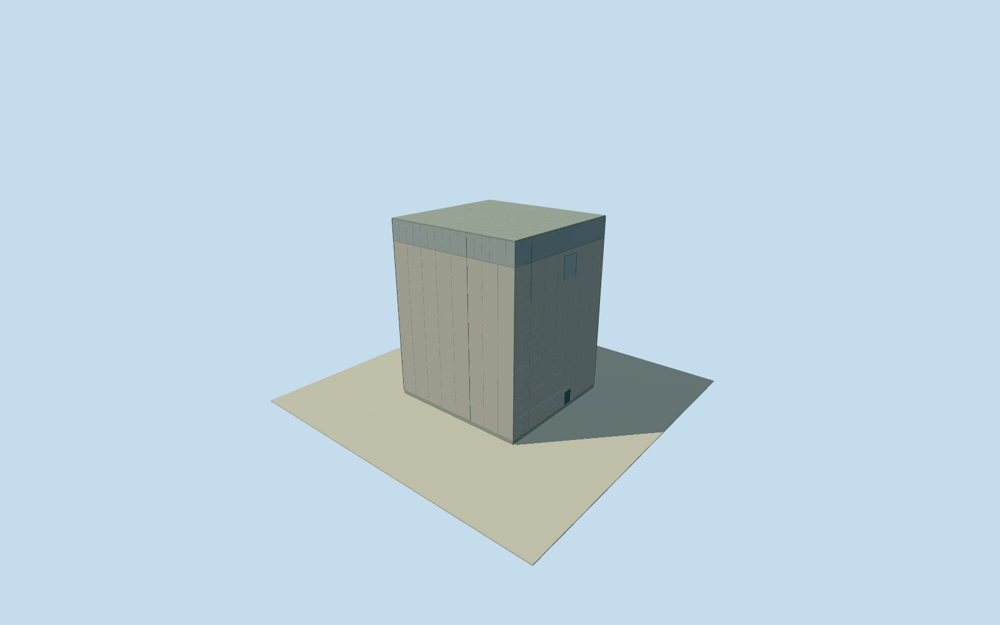

# Daiichi Unit 6 reactor building

WholeUnit6abovegroundreactor/all8originalnativecorners,operator42.5x45.5mabovegroundbodyand55.65mabovegradeheight,concretemainwalls/steelroof/closedentries/upperpanel. Largerundergroundbaseandinternalcontainmentomitted. Finefinish/roofnotches/2021continuityestimated;allappearanceimagesunused.

Authoring state: **review-in-qa.json**. Current completion evidence is in [qa.json](qa.json) and the [completion ledger](../../../../qualla-structures/batches/qualla-002.PROGRESS.md).

- [Fukushima Daiichi Nuclear Power Plant](https://qualla.com/fukushima-daiichi-nuclear-power-plant/)

Whole independentabovegroundUnit6reactorbuildingexterior/all8originalnamednativecorners/completewallsandclosedroof. Originaloperator42.5mNSx45.5mEWabovegroundbody/55.65mabovegradeheight;substantiallylarger68.25x68.50mundergroundfoundationnotextrudedaboveground. Internalcontainment/reactorequipmentandadjacentturbine/wholeplantseparate. Allappearanceimagesunused,currentQualla-first25families/0conflicts. Cleared1971DOEoriginalspredatecompletedUnit6andnotapplied. Originaloperator17August2011section3.1writtenwholeabovegroundplan42.50mNSx45.50mEW,height55.65mabovegradeversus72.65mfromfoundation,6above/2belowfloors,reinforcedconcreteandsteeltrussroof. OriginalnumericOP68.65roof/OP51.50operatingfloor/OP13.20firstfloor/OP13ground. NativeOSMunitname/8cornerscloseprimaryabovegrounddimensions;exactheightpartitions/smallroofnotches/finishesunobserved,8mhorizontal/3degreeheading/3mheight/2mcomponentuncertainty. Nominal2021-05-09sourceupdatepreviewuses2011writtensections;temporalcontinuityunverified,currenteligiblefalse. Originalsourceimages/reportfigures/plans/photos/maps/satellitesunused.

Originaloperator17August2011section3.1printed3-1/PDFpage5:wholeaboveground42.50mNSx45.50mEWbody/55.65mabovegrade,72.65mfrommat,6above/2belowfloors,reinforcedconcrete/steeltrussroof. Underground68.25mNSx68.50mEWfoundationomittedfromexteriorandnotextrudedaboveground. No internalcontainmentvesselordomeproxy.

All8fullnativecornersretainabovegroundenvelopewhichcloselymatcheswritten42.5x45.5mplan. Nativewallnotchesandpreciseheightpartsareunsurveyed. OriginalnumericPDFpage7roofOP68.65/firstfloor13.20/ground13/6F51.50/cranelevel62.00. Derivedfirstfloorroofheight55.45m,operatingfloor38.30m,cranelevel48.80m. Floor.25/mainroof55.70 retains55.45mfloorrelativeheight, .05mnominalgroundoffsetversusoriginal.20mfirstfloorabovegradeisexplicitapproximation. Modelconcretetop49.05usescranelevel;upper6.65mmetalcladdingskin/flatgrayroof/paneljoints/twoclosedserviceentries/upperlargeclosedpanel/hiddenfinishesestimated2m. Exteriorcladdingmaterial/colorarenotobserved;floorlevelsdonotimplywindowcensus.

Ownoriginal256m129x129field16641values/2rawtiles/datum22.0496m frozenBEFOREfloor.25/foundation-1.2/concretetop49.05/mainroof55.70m. No sourcefield/frame/floor/mainsection refit/reframe/flatten/mask. Compositefieldcancontainbuildingreturns;groundcontactandhistoricverticaltieunverified.

Native2021-05-09updatepreview/2011writtenengineeringcontinuityunverified,currentWorldEligiblefalse. Originalheightassignedtofullnativeenvelope3muncertainty/8mhorizontal/3degreeheading;fineparts2muncertainty. Allappearanceimagesunused;Qualla-first25families/0conflicts,cleared1971DOEoriginalspredatecompletedUnit6andnotapplied. Everyoperatorreportfigure/plan/photo/map/satelliteimageunused. Neighboringturbine/otherunits/siteinfrastructureandwholeplantremainseparateandunfinished.

Build: `node content/worldgen/source/places/xn/xns/daiichi_unit_6_reactor_building/models/generate-house.mjs`. Add `--check` to verify exact regeneration. 2218 triangles; 5 materials; no embedded photographs.
