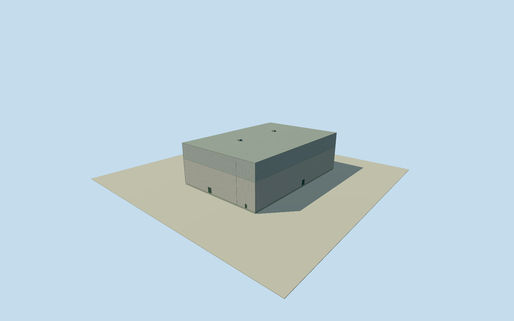

# Daiichi Unit 6 turbine building

Whole independent Unit6 turbine building: all11fullnativecorners, operator32.3mmaximumheightassigned3muncertainty, concretebody/steelupperhall/fullclosedroofs/lowerattachedservices/closedentries and2estimatedroofvents. Highhallpartition/finefinish/2019continuity explicit estimates; no appearance images used; reactor and otherunits separate.

Authoring state: **review-in-qa.json**. Current completion evidence is in [qa.json](qa.json) and the [completion ledger](../../../../qualla-structures/batches/qualla-002.PROGRESS.md).

- [Fukushima Daiichi Nuclear Power Plant](https://qualla.com/fukushima-daiichi-nuclear-power-plant/)

Whole original separatelymapped Unit6 turbine building, all11originalcorners/fullmainbody/intrinsicwesternserviceprojection/completewallsandclosedroofs. Physicalidentityinferredfromsharedoriginalcorners/adjacencywiththeexplicitlynamedUnit6reactorandunit-specificprimarydimensions;notanexplicitnativeturbinenametag. Reactor/internalcontainment/otherunits/wholeplantremainseparate. Allappearanceimagesunused, Qualla-first25families/0conflicts;cleared1971DOEoriginalspredatethesefinishednorthernunitsandnotused. Originaloperator17August2011section3.6.1writtenmainengineeringdimensions105.5mNS/71mEW,abovegradeheight32.3m versus46.1mfrommat,threeabove/onebelowfloors,reinforcedconcrete/steeltrussroof. Fullnative2019updatedenvelopeincludesattachedreturns;nativeheight/facade/roofpartattributesabsent. Mainroofheightassignedwith3muncertainty;highhallandlowerserviceroofpartitionsestimatedwith6mtieruncertainty. Nominal2019previewusesrelativeidentityfromnamedreactorrecordupdated2021;temporalcontinuityunverified,currenteligiblefalse. Lightgrayfinish/flatroofs/closedentries/twoestimatedvents/paneljoints/hiddenwallsestimated2m. No reportfigures/plans/photos/maps/satelliteimages/phototexturesused.

Original17August2011operatorwrittensection3.6.1 explicitlyUnit6turbinebuilding: engineeringmainplan105.5mNS/71mEW,abovegrade32.3mversus46.1mfrommat,3above/1belowfloors,reinforcedconcrete/steeltrussroof. Nativewholeenvelopeincludesattachedreturns;maximumheightassignedtomainbodywith3muncertainty,notaseparateroofsurvey. No foundation-to-roofvalueusedasabovegroundheight, no internalcontainment/turbineinteriorsmodeled.

All11fullnativecornersretainedinwholebase/lowbodyandclosedroof; estimatedhighhall7cornerpartindices0/1/2/3/4/5/6excludewesternintrinsicserviceprojection. Unit6operator3FOP33.00minusOP13sitelevelsupplies20mstructurallevel,usedasanestimatedlowserviceroofwith6muncertainty;notasourcedroofpartoutline. Mainpartpartition/flatgrayroof/plainlightconcreteandcladupperwalls/twoestimatedventhouses/entrycounts/paneljoints/hiddenfinishesestimated2m. NamedreactororiginalsharedcornerssupportUnit6turbineidentityinference,notnativeexplicitwayname.

Eachoriginalown256m129x129field16641values/1rawtile/datum14.3519m acquiredBEFOREfloor.25/foundation-1.2/lowroof20.25/mainroof32.55m. No field/frame/floor/mainsection mask/flatten/refetch/refit/reframe. CompositeDEMnotasurveyofhistoricground;actualOPdatumtie/grade/contactunverified. NativefieldsourcepixelsoversamplecoarserDEM.

Nominal2019-11-09preview uses2019updatedturbineoutline/2011engineeringfacts/2021updatednamedreactorrelativeidentity;temporalcontinuityunverified,currentWorldEligiblefalse. No2019surveyorobservedfacadecensusclaimed. Allappearanceimagesunused,currentQualla-first25families/0conflicts;1971clearedDOEoriginalspredatecompletednorthernunitsandnotapplied. Everyreportfigure/plan/photo/map/satelliteimageunused. Parentplantandotherphysicalmembersremainseparateandunfinished.

Build: `node content/worldgen/source/places/xn/xns/daiichi_unit_6_turbine_building/models/generate-house.mjs`. Add `--check` to verify exact regeneration. 4557 triangles; 5 materials; no embedded photographs.
