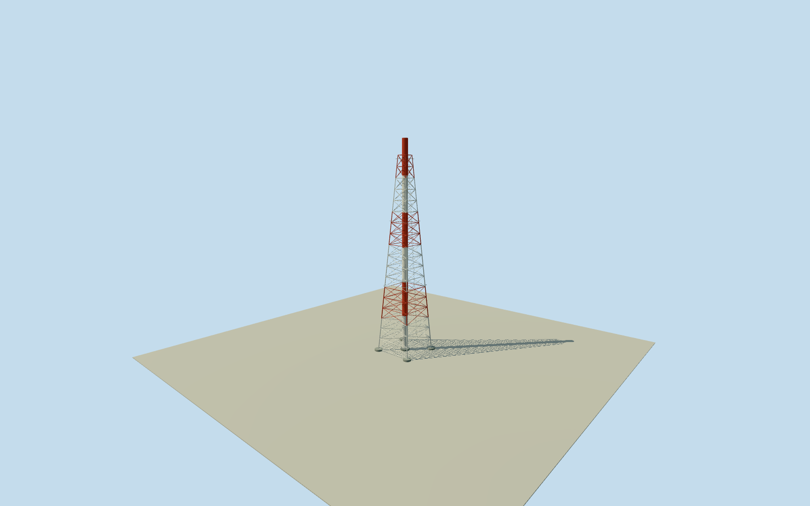

# Daiichi Units 1/2 exhaust stack

Wholeintacthistorical120m sharedflue/111msquarelatticetower,22mbase/5.4mtop/fourlegs/fullbracing/4.6mpiers/3.2mbore. Redwhite bandingfromclearedDOEoriginals, exactdetailsand25mgeographicregistration estimated. Notcurrent59mcutoff.

Authoring state: **review-in-qa.json**. Current completion evidence is in [qa.json](qa.json) and the [completion ledger](../../../../qualla-structures/batches/qualla-002.PROGRESS.md).

- [Fukushima Daiichi Nuclear Power Plant](https://qualla.com/fukushima-daiichi-nuclear-power-plant/)

Whole intactcirca1971sharedUnit1/2exhauststack:120m hollowmouth centralflue inside111m square taperedsteel lattice tower,22m legspan/5.4m toplattice, fullfourlegs/diagonalbracing/horizontalrings/four4.6mfootings and estimatedaccessladder/maintenance details. Geographicpoint manually estimated25muncertainty fromclearoppositeaerials, no exactnativelocation claim. Otherreactors/turbine/radwaste/pylons/cranes/site separate; parentunfinished.

Primary2017operatorwrittenbullet facts: flue120m/internaldiameter3.2m, squaretubularsteeltower111m/basewidth22m/topwidth5.4m, pierdiameter4.6m/buriedlengthabout10m. Approximatephotographicposition immediatelysouthofUnit1reactor andwestofUnit1turbinehall, anchor25muncertainty. Authored26.6m footingenvelope around22mlegspan, not a nativefootprint. Contemporaryanonymoussmallbuilding mustnotbecome exactstackidentity.

Operator2017originalwrittenbullet facts:120m pipe/internaldiameter3.2m;111m squaretubularsteel lattice tower/basewidth22m/topwidth5.4m;4.6m piers/about10m buriedlength. Fulloriginal120m phase retained;59mpost2020cutoff not applied.2017dimensions carriedback toc1971 withminorretrofit uncertainty. Everyoperatorreportphoto/figure/diagram pixel unused; only writtenbullet/numericalfacts.

Geographicanchor is boundedmanual estimate relativeto completedUnit1reactor fromtwoalreadycleared oppositeaerials:25mhorizontaluncertainty/15degreefacinguncertainty. Not surveyed/nativepoint/calibratedphotogrammetry. Nearbycompiledsmallbuilding notidentifiedasstack; APIs429 saved, no repeatedrequestloop.

Intermediate taper linearbetween22mbase/5.4mtop, bracecensus/memberwidths/.05m pipewallthickness, footingexposure/centralpad, ladder/platform/bearingdetails and redwhitepainttransitionheights are explicit estimates. Actualsquare111msupport/full120mcentralpipe/bore3.2m/fourlegspan retained. Buried10mpiers/undergroundductrouting omitted; shortinnerlip/darkocclusion cap simplify unseeninterior, not measuredrouting.

Original256m129x129field/16641heights/4tiles/datum17.8182m fixed BEFORE floor.25/foundation-.9..+.25/latticetop111.25/mouth120.25m. Historicabsolutegrade/contact notsurveyed; currentDEMmayhavehill/building/cliffreturns. Do notflatten/mask/refetch/reframe/refit.

Qualla-first25families/zero conflicts; same twoalreadyclearedpublishedDOEoriginals. Fullredwhitelattice/centralpipe visible; othercranes/pylons/buildings/roads/landscape excluded. Wholeindependentstack, not wholepowerplantproxy. No newquestionableimagery orphototextures; olderacceptedmodels untouched.

Build: `node content/worldgen/source/places/xn/xns/daiichi_units_1_2_exhaust_stack/models/generate-house.mjs`. Add `--check` to verify exact regeneration. 15838 triangles; 3 materials; no embedded photographs.
