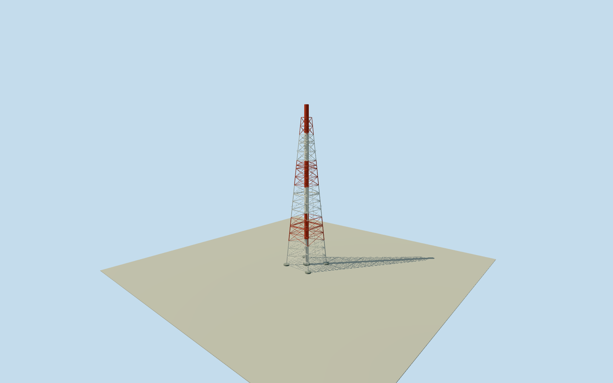

# Daiichi Units 3/4 exhaust stack

WholeUnit3/4sharedstack:120mflue/111mtopsupport,fiveoriginalsupportlevels/twowrittenplatformlevels,fullopenlattice/fourlegs/fivefootings/hollowmouth.22m/5.4mwidths,3.2mbore/4.6mpiers are explicit3m comparisonestimates; authorinter-reactorpoint50mnominaluncertainty,not native/surveyed. Allappearanceimageryunused;2021phasecontinuity/finish/grade estimated.

Authoring state: **review-in-qa.json**. Current completion evidence is in [qa.json](qa.json) and the [completion ledger](../../../../qualla-structures/batches/qualla-002.PROGRESS.md).

- [Fukushima Daiichi Nuclear Power Plant](https://qualla.com/fukushima-daiichi-nuclear-power-plant/)

Whole approximately positioned Unit3/4sharedexhauststack in nominal2021phase:120mcentralflue/111mtopsteeltowersupport,fourfulllegs/squaretaper/braces,fivewrittenfluesupportlevels,twointermediateplatformlevels,fourpiers/centralpad andhollowmouth. Towerwidth/bore/footing/detail values are explicit comparisons to1/2, not silent exact3/4measurements. InternalSGTSrouting/undergroundducts/otherplantstructures omitted; not a wholeplant proxy. All appearance imagery unused. Qualla-first25families/zero conflicts. Two alreadycleared1971DOEoriginals inspected fornewstack suitability; onlyUnit1/2stack established, so not adopted for3/4. Actual originaloperator2025PDF48/65 explicitly gives120mheight,111/94.2/76.4/54.8/30msupportlevels,44.4/86.16mplatforms,approximately415t, and says3/4structure almostsameas1/2 exceptinternalSGTSpipe. Original2017Unit1/2numericalfacts22mbase/5.4mtop/3.2mbore/4.6mpiers are adopted as3/4comparisonestimates with3msection uncertainty,not exact3/4dimensions. Anchor is an author midpoint estimate between originalreactor3/4contexts with50m nominalallowance/15degreefacinguncertainty,not a verifiednativechimneypoint. Finish/paintbands/bracecensus/ladder/platformwidths2m estimates;2021continuity/groundtie unverified,currentfalse. Everyreportfigure/plan/photo/map/satellitepixel unused. OriginalOSM/infrastructure/USGSpixelcampaigns not repeated.

Originaloperator2025PDF48/65 explicitly identifies3/4sharedstack,120mheight,topfluesupport111m,otherfluesupports94.2/76.4/54.8/30m,intermediateplatforms86.16/44.4m andapproximately415t. It calls the structure almost the same as1/2 exceptinternalSGTS. These written/numericalvalues are adopted; no reportimage/figure/planpixel viewed or used.

Original2017Unit1/2written22mbase/5.4mtop/111mtower/3.2mbore/4.6mpiers are comparison estimates for3/4,not exact3/4measurements.3msection uncertainty;linear taper/memberwidths/bracecensus/pipewall.05m/centralpad/platformwidth/ladder and footexposure2m estimates.111msteel support extent follows originaltop-support and comparison,not a steelmember survey. Hollowmouth has a short darkinnerlip/occlusion floor2mbelowrim; actualinternalSGTS/ducts/buriedpiers omitted.

Anchor is author visualization midpoint of sourceUnit3/4reactor-bodycontexts; no native stackpoint was found or invented.50mnominalposition allowance/15degreefacing are assumptions,not verifiederrorbounds. This is an approximate historicalcatalogplacement,not a survey or calibratedphotogrammetric reconstruction. Existingreactor/turbine/cover positions/QA unchanged.

Redwhitepaintscheme/bandboundaries andneutralsteel/concrete finish are author visualization estimates,not appearance copied from the excluded1971images or operatorreportpictures. Exact2021finish/corrosion/retrofits and capture-datecontinuity unverified,currentfalse.

Ownoriginal256m129x129field16641values/2rawtiles/datum16.1227m frozen BEFORE floor.25/foundation-.9..+.25/tower111.25/flue120.25m. No terrain/frame/floor/mainsectionmask,flatten,reframe,refit or later renderfitting. CompositeDEMcaninclude vegetation/buildingreturns; nominal2021grade/verticaltie notsurveyed.

Qualla-first25families/zero conflicts; two cleared1971DOEoriginals inspected for this newsource decision and excluded because3/4stackappearance unbound. Allappearanceimagery/reportfigures/plans/photos/maps/satellitepixelsunused. Nominal2021carryback fromactual2025structure unverified. Wholeplantandotherphysicalmembersremain separate.

Build: `node content/worldgen/source/places/xn/xns/daiichi_units_3_4_exhaust_stack/models/generate-house.mjs`. Add `--check` to verify exact regeneration. 17322 triangles; 3 materials; no embedded photographs.
