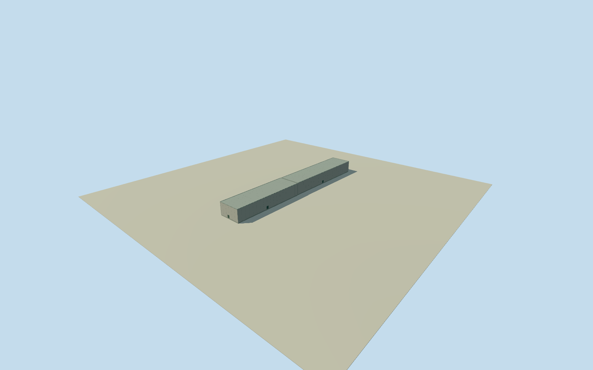

# Daiichi Units 3/4 turbine service wings

Whole estimated low west service wings of Unit3/4 turbine buildings. Two full bands share original native mainhall west edges; far west edges use operator67.6m major EW width with8m plan uncertainty. Low16.9m height estimate6m; mainhalls/reactors/covers remain separate. All appearance imagery unused;2021continuity/registration approximate.

Authoring state: **review-in-qa.json**. Current completion evidence is in [qa.json](qa.json) and the [completion ledger](../../../../qualla-structures/batches/qualla-002.PROGRESS.md).

- [Fukushima Daiichi Nuclear Power Plant](https://qualla.com/fukushima-daiichi-nuclear-power-plant/)

Whole estimated western low service wings intrinsic to Unit3 and Unit4 turbine buildings. Two separate full quadrilateral bands follow their complete native mainhall west edges; far west edge is estimated using original operator67.60m total major building EW width and source east-edge context. Original127.15/105.15m NS lengths are checks, not a rescaled native outline. Existing accepted mainhalls, reactors and fuel-removal covers stay separate and unchanged. No filled yard or wholeplant proxy. All appearance imagery unused. Qualla-first25families/zero conflicts,cleared1971DOE photographs predate these units and are not adopted. Actual original operator2011sections3.3.1/3.4.1 give respective127.15/105.15NS x67.60EW major rectangles,25.75m abovegrade highroofs/three above floors; these are not a measured low-wing plan or height. Two added west bands complete an approximate engineering building envelope:8m horizontal/section-registration uncertainty,6m low-roof height uncertainty. Neutral concrete walls/flat metal roof/parapet,closedentries/paneljoints estimated2m. Unit3 identity explicit; Unit4 inferred from original immediately southern aligned source body and105.1m NS extent. Native2019/2021geometry combined for nominal2021-03-11, continuity/repairs/verticaltie unverified/currentfalse. No borrowed Daini dimensions, reportfigures/photos/maps/satellitepixels or oldacceptedmodel reauthoring.

Original operator2011 Unit3/4 major turbine plans127.15/105.15NS x67.60EW and25.75m high roofs are written dimensional context only. Original native west mainhall edges bind the east wing sides; far west sides are offset from source east mainhall context using67.6m. Added low wing plans/segmentation are explicit8m estimates, not original mapped ground footprints. Native NS spans retained without resizing to the written numbers. Existing mainhalls and their QA unchanged.

Both full low ancillary wing bands are shown at estimated16.9m above floor/roof17.15m,6m height uncertainty. Neutral concrete walls/flat paintedmetal roof/.3m parapet/facade joints/closedserviceentries/finish are2m estimates,not measured exterior or equipment census. No turbine machinery/interior, neighbouring reactor/cover, crane/site/yard-fill geometry.

Nominal2021phase combines original2019Unit3 and2021Unit4native geometry; continuity/repairs and inferredUnit4identity unverified/currentfalse. Western bands may share reactor low-terrace roof segmentation; no independent building-count/ownership claim and no whole-parent completion proxy.

Own512m129x129field16641values/4rawtiles/datum9.1448m frozen before floor.25/foundation-1.2/roof17.15. Originalcoastalfieldmin-201.0052m is retained as sourceDEM artifact,not physicalbathymetry; PNGerror.001839m. No mask,flatten,reframe,refit or cross-member floor fitting. Actualgrade/verticaltie unverified.

All appearance imagery unused. Qualla-first25families/zero conflicts;1971DOEoriginals predate units3/4 andnotapplied. Originaloperatorwritten/numericaltext and attributed Overture/OSM geometry only. Everyreportfigure/plan/photo/map/satellitepixel unused.

Build: `node content/worldgen/source/places/xn/xns/daiichi_units_3_4_turbine_service_wings/models/generate-house.mjs`. Add `--check` to verify exact regeneration. 2068 triangles; 4 materials; no embedded photographs.
