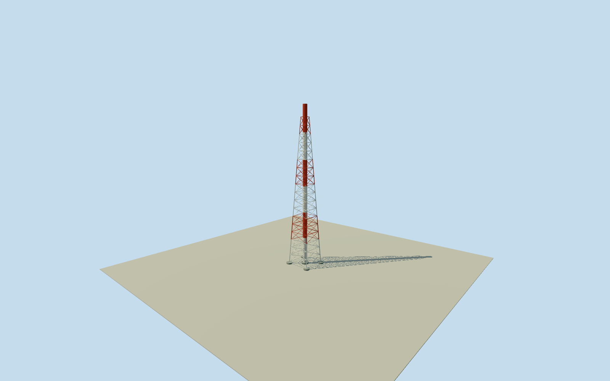

# Daiichi Units 5/6 exhaust stack

Whole northern5/6sharedstack:120mflue andfullestimated111mfour-legsteel frame/braces/fivefootings/hollowmouth. Originalfourcornertowerenvelope retained asapproxlegcontext;5/6roleinferredfromnorthgroup/four-stackcensus. Frameheight10m/legrole4m/top3m/bore1m/details2m estimates. No3/4footboards/platforms/ladder added. Allappearanceimageryunused;2021continuity/grade unverified.

Authoring state: **review-in-qa.json**. Current completion evidence is in [qa.json](qa.json) and the [completion ledger](../../../../qualla-structures/batches/qualla-002.PROGRESS.md).

- [Fukushima Daiichi Nuclear Power Plant](https://qualla.com/fukushima-daiichi-nuclear-power-plant/)

Whole approximately reconstructed northern5/6shared exhauststack:120mflue,fullestimatedtaperedfour-legsteel frame/fullbraces,fourpiers/centralpad/hollowmouth. Original4cornermappedtowerenvelope retained as approximatelegcontext; original5/6identity inferred fromnorthgroup/four-stackcensus. No added3/4stylefootboard platforms.111msteelheight/topwidth/bore/footings/paint/bracecensus are explicitfamily estimates,not measured5/6dimensions. Internalducts/SGTS/buriedfoundations/wholeplant separate. Allappearanceimageryunused;Qualla-first25families/zero conflicts,cleared1971DOEoriginals predate5/6 andnotapplied. Indexedoriginaloperator/regulator120mphysicalheight plus actualfour-stackcensus/5/6steel-tower/no3-4stylefootboards facts retained as honest extractedcache,not originalPDFbytes. Fresh2019METI403closed. OriginalOSMmapAPI now200 afterprior-daytemporary429; fourmappedflare/towerquads retained with originaltags. Northernmostway743623813 near5/6providesapproximateposition/baseenvelope; exactsystemidentity andlegcornerrole inferred,not originalname/survey.111msteeltop10muncertainty,baselegrole4m/top/bore/feet estimates fromgeneric120mstackfamily. Nominal2021continuity/paint/gradeunverified,currentfalse. No operatorpicture,plan,figure,map orsatellitepixel used.

Original indexed operator/regulatornote explicitly gives5/6physicalstack120m.65mplumeeffectiveheight/95mmeteorologicalwindreference are not physicalstackheight. Actual2019operatorfour-stackinspection explicitly describes5/6steel tower and absence of3/4stylemaintenancefootboards. Both indexed source facts honestly retained as extractedcache,not originalPDFbytes; direct2019METI403closed. Reportphotos/figures/plans unused.

OriginalOSMmapresponse200fourflare/towerways andallnativequadnodes retained. Northernmostway743623813near5/6supportsapproximateposition/outline; role is inferred,not an explicitnative5/6exhaustname. Exactlegcentre role forfouroutercorners has4m uncertainty; it is not a footing/steelsurvey. The southern3/4-area RemoteMonitoringSystemTowername remains an explicitsourceclassificationconflict and isnot silently renamed as fact.

Mainframe111mheight is an authorconstruction estimate with10muncertainty,not a measured5/6value. Nativebasequad approximately18.1x17.0m used as fourlegcontext; top4.5mspan estimated3m. Fluebore3.2m/pipewall.05m/piers4.6m/centralpad follow generic120mindustrialstack family numericalcontext,withbore1m/feet2muncertainty,not claims of identical1/2or3/4dimensions. Full4legs/braces/footings/hollowmouth retained. No added3/4footboards/platforms; ladder/rungs/internalSGTS/ducts/buriedfoundations omitted as unobserveddetail,not proof ofabsence.

Redwhitepaintscheme/bandboundaries,bracecensus/memberwidths/linear taper,smallmouthrim/innerlip/darkfloor2mbelowrim andneutralfinish are author2mvisualization estimates,not image-derived2021appearance. Nominal2021sourcegeometry/conditioncontinuity unverified,currentfalse.

Ownoriginal256m129x129field16641values/2rawtiles/datum18.5066m fixed BEFOREfloor.25/foundation-.9..+.25/estimatedtower111.25/flue120.25. No sourcefield/frame/floor/mainsectionmask,flatten,reframe,refit or cross-member groundfitting. Actualhistoricground/verticaltie unverified; sourceDEMincludesvegetation/building/cliffreturns.

Allappearanceimageryunused;Qualla-first25families/zeroconflicts. Cleared1971DOEoriginals predate5/6andnotapplied. Originalprimaryindexednumerical/textfacts,original2017genericfamilycontext andattributedOSMgeometryonly. Everyreportfigure/plan/photo/map/satellitepixelunused. Otheracceptedmodels/fields/frames/floors/QA unchanged; wholeplantseparate.

Build: `node content/worldgen/source/places/xn/xns/daiichi_units_5_6_exhaust_stack/models/generate-house.mjs`. Add `--check` to verify exact regeneration. 9178 triangles; 3 materials; no embedded photographs.
