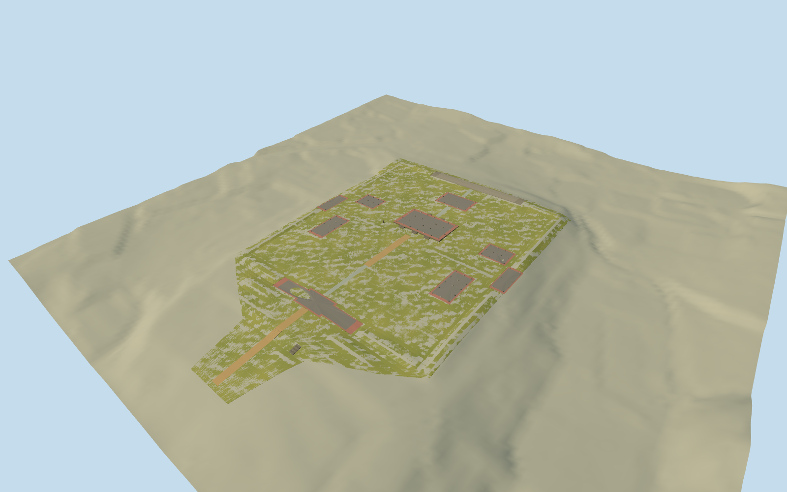

# Taga Castle

The excavated central government enclosure at Taga Castle, including the main plinth, associated foundation stones and south approach.

Authoring state: **review-in-qa.json**. Current completion evidence is in [qa.json](qa.json) and the [completion ledger](../../../../qualla-structures/batches/qualla-004.PROGRESS.md).

- [Taga Castle](https://qualla.com/taga-castle/)

The modeled scope covers the present central archaeological enclosure and immediate approach. The modern full-sized outer gate is south of this scope.

The visible plinth and bank heights use the native terrain and exterior photographs. Small marker stones, gravel edges and individual stair risers are representative.

Build: `node content/worldgen/source/places/xn/xnu/taga_castle/models/generate-taga-castle.mjs`. Add `--check` to verify exact regeneration. 22953 triangles; 4 materials; no embedded photographs.
