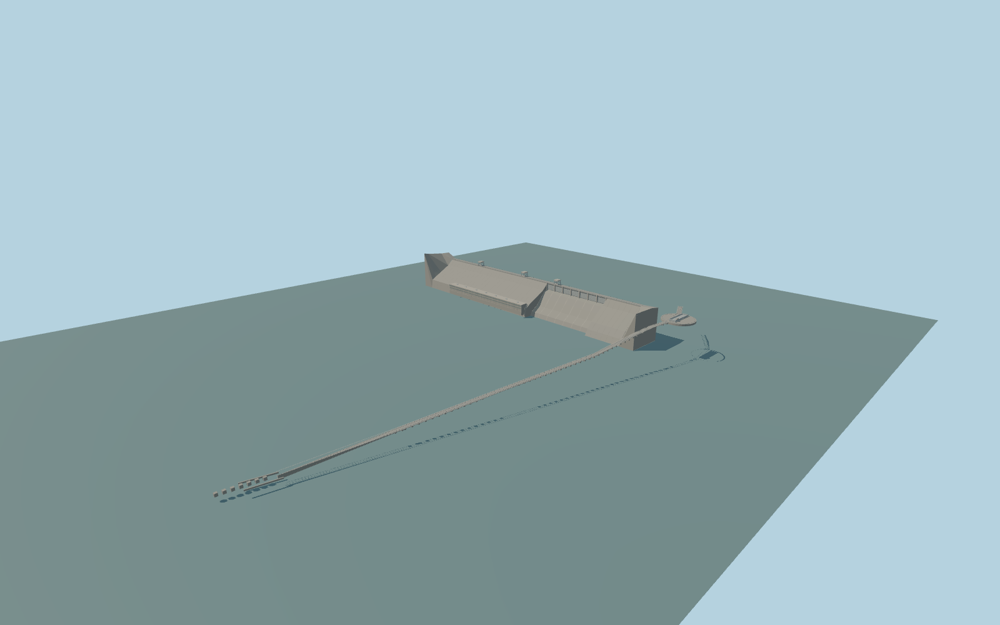

# Krasnoyarsk Dam

Krasnoyarsk gravity dam, spillways, crest gantries, right-bank power hall, and northwest ship lift including the upper reach, turntable and mapped descending alignment.

Rebuild: `node packages/worldgen/scripts/generate-krasnoyarsk-dam.mjs`;append `--check` for exact source bytes. Select import/LOD/placement with `--ids=krasnoyarsk_dam`. Detailed source and four browser tiers are separate ignored GLB outputs.

The standard Terrarium reference at local [0, −420] gives a 223.02 m upstream datum. The lower Yenisei reference at [0, 420] is 85.93 m below it. Crest, concrete, rail and caisson elevations are approximate visual fits.

The 16 m standard terrain contains isolated anomalous low samples, especially around shorelines. The raw fixture retains all input values and some bank seams remain visible.

The visible gate division and parked caisson represent the ordinary photographs and mapped facility. Gate machinery, crane positions, rail heights and caisson dimensions remain approximate.

The native downstream road bridge and other mapped transportation remain. The modeled lift bed replaces only its own mapped elevated rail segment. Distant switchyards and separate utility buildings remain in the map context.

Original geometry:repository license. Map:© OpenStreetMap contributors,ODbL-1.0;Protomaps. Standard terrain:terrain-grid.json. Ordinary pictures stay local and are not redistributed or used as textures. Current acceptance:qa.json.
