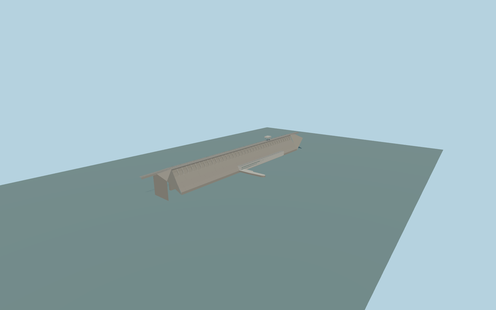

# Bratsk Hydroelectric Power Station

Bratsk concrete gravity wall, deep crest ribs, highway and electrified double-track railway, crest gantry, generator hall, and downstream retaining spur.

Rebuild: `node packages/worldgen/scripts/generate-bratsk-dam.mjs`;append `--check` for exact source bytes. Select import/LOD/placement with `--ids=bratsk_hydroelectric_power_station`. Detailed source and four browser tiers are separate ignored GLB outputs.

The standard Terrarium upstream sample at [0, −480] gives a 390.99 m model datum. The Angara reference at [155, 420] is 99.95 m below it. The wall, crest, hall and transition levels are visual fits.

The slope, ribs, powerhouse, railway and crest gantry follow ordinary photographs and PMTiles. The exact rib spacing, crest equipment and engineering elevations are approximate.

The mapped highway, double-track rail and sidewalk are replaced only across the owned crossing. Native continuation and neighboring transportation remain mapped.

The standard 16 m raw terrain contains isolated height anomalies. The occupied spur cut clips nearby shore curtains within the model footprint.

Original geometry:repository license. Map:© OpenStreetMap contributors,ODbL-1.0;Protomaps. Standard terrain:terrain-grid.json. Ordinary pictures stay local and are not redistributed or used as textures. Current acceptance:qa.json.
