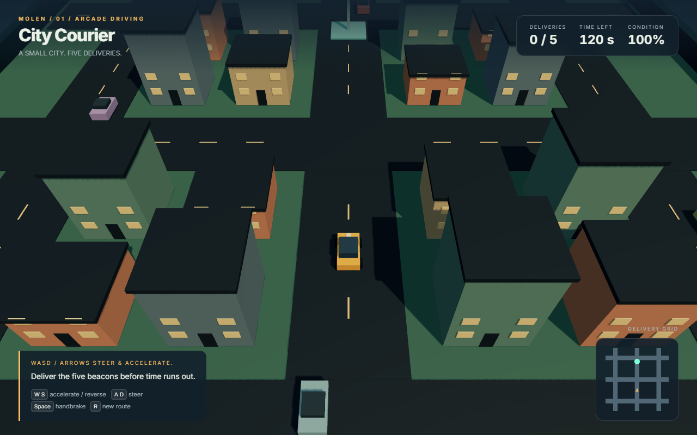
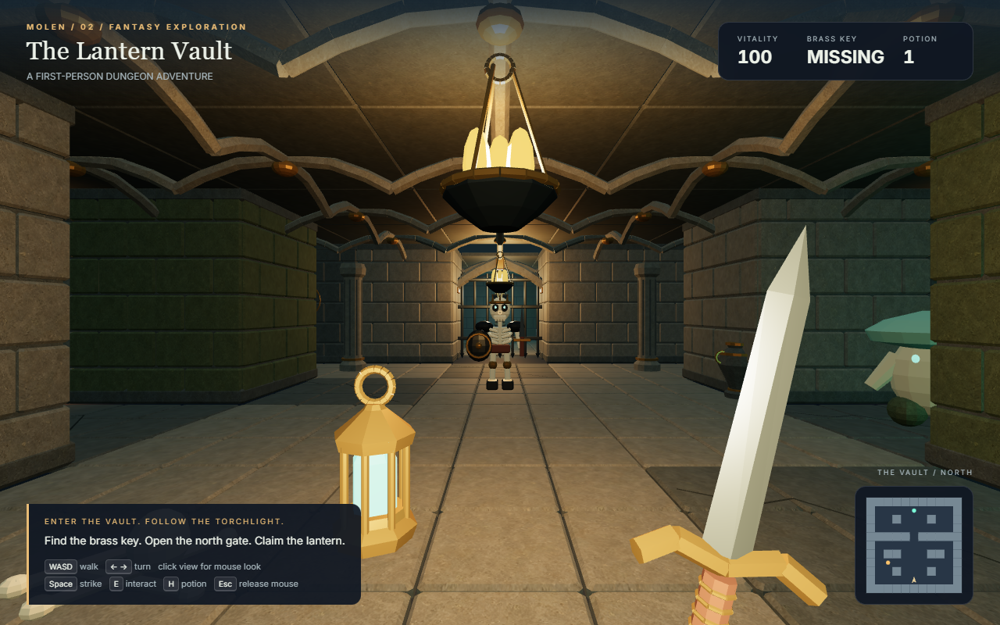
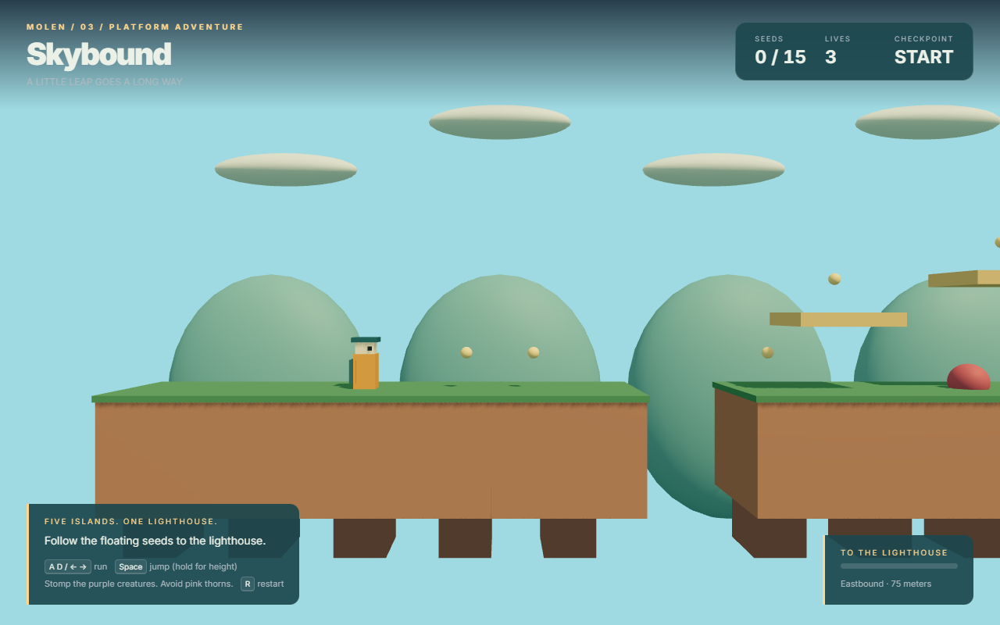

# Play with Molen

You do not need this repository to play or copy the samples. Every one of them plays in the
browser at [molen.dev/play](https://molen.dev/play/), and the smaller ones ship in the npm
packages as templates (`npx @bendyline/molen-tooling new my-game --template skybound`; see
[the samples gallery](https://molen.dev/guide/examples)). The rest of this page is for working
inside the engine repository.

From the repository root, install once:

```sh
pnpm install
pnpm dev:prepare  # restore/generate assets and package content once
pnpm dev          # start the gallery with the prepared content
```

Each launch command builds its engine dependencies automatically. The games use the runtime
assets already in the repo; playing requires no art-generation step or Python installation.

Normal `pnpm dev` compiles engine code and reuses the prepared content packs, even when asset sources have changed.
It does not fetch or regenerate models or rebuild content archives. After a targeted model rebuild
and import, run `pnpm dev:content` to refresh the browser's packs. `pnpm dev:prepare` is the
explicit first-time setup: `assets:fetch` may build models when the current source bundle has
not been published. Production builds and CI continue to prepare and verify current content.
The `dev` and `dev:packages` commands compile with `tsdown` directly so unfinished content
authoring does not run the full model-library validation during app development.

| Game | Launch | Authoring guide |
|---|---|---|
| **City Courier** | `pnpm dev:driving` | [Driving, traffic, deliveries and damage](city-courier/README.md) |
| **The Lantern Vault** | `pnpm dev:dungeon` | [First-person exploration, combat, keys and gates](lantern-dungeon/README.md) |
| **Skybound** | `pnpm dev:platformer` | [Jumps, ledges, collectibles and checkpoints](skybound/README.md) |





These games share scene data, deterministic scene scripts, headless simulation, a Worker
host, and the standard browser client. Each has a complete win/loss/restart loop, input schemas,
headless assertions, checkpoint tests, a command-only victory regression, and a browser test.
See [the shared services guide](https://molen.dev/guide/game-samples) to reuse their camera and physics patterns.

For smaller building blocks and terrain demos, see the [full examples gallery](https://molen.dev/guide/examples).

See [editable assets and ready-to-run games](ASSETS.md) for the source/runtime storage contract,
hand-editing workflow, freshness checks and deployment instructions.
