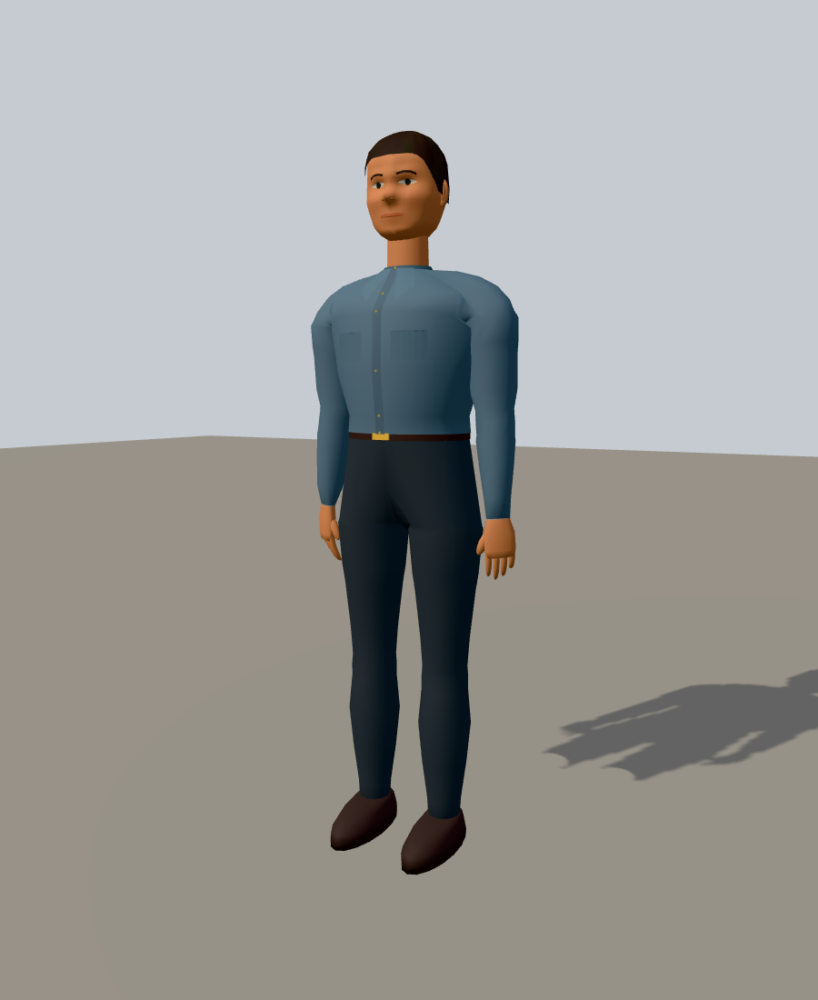
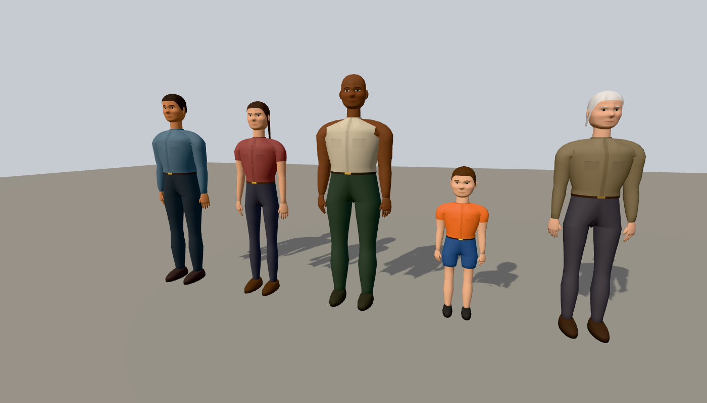

# Human model review

Reviewed 2026-10-22. The brief was to replace the primitive human bodies with believable
early open-world polygonal characters, using GTA III as the visual reference, while preserving
the existing locomotion, poses, sockets and palette customization.





## Implementation

The shared procedural biped now has an anatomical jaw, cheeks, brow ridge and nose; surface-following
eyes, eyelids, brows and lips; modeled ears and hairlines; shaped shoulders, elbows and knees;
shirt collars, buttons and pockets; a continuous trouser yoke and belt; shaped palms and five digits;
and rounded shoes with soles. Pigment variation and geometric relief respond to normal scene lighting.
The mesh builder's inverted loft/cap winding was also corrected, including the quadruped leg axes.

Source is in `src/kernel/body-biped.ts`, `body-human-head.ts` and `body-human-extremities.ts`,
with the common mesh builder in `skinned-mesh-builder.ts`. Existing figure entities and ambient
walkers consume this same generator. The canonical 22-joint hierarchy, limb lengths and socket names
are preserved. Hands are detailed by default; `hands: "mitten"` remains available.

The shoulder refinement joins each sleeve directly to an armhole in the torso, with shared vertices,
rounded intermediate rings and blended chest/arm weights. The upper arm tapers into a softer elbow
and forearm silhouette. The biped bind pose now holds the arms five degrees from vertical instead of
fifteen; idle adds a nine-degree elbow bend and small shoulder/wrist adjustments so hands hang beside
the thighs. This also fixes the rigid distant tier's arm position. Falling compensates for the changed
rest angle to preserve its original arm spread. Walking and running keep their existing swing cycles.

The arm profile keeps fuller volume through the elbow and tapers gradually toward the wrist.
It removes the narrow elbow followed by a forearm bulge that produced an hourglass silhouette,
including on the medium and rigid distant tiers. The same ring count, skin weights and hand poses
are retained. Standing, bent-arm and bare-arm renders were checked after this adjustment.

The hand refinement adds mirrored axial forearm rotation: 55 degrees at idle, 40 while walking
or sitting, 20 while running and 35 while jumping. Rotating about elbow-to-wrist preserves wrist
positions and makes the hand and lower arm turn together. Idle adds five degrees of wrist flexion.
The fingers now follow gently curved surfaces, with more curl toward the little finger, and the
thumb rests closer to the palm. The rigid distant mesh bakes the resting forearm twist and uses
a curved merged-finger silhouette. The custom pose and explicit joint overrides remain available.

The default 1.75 m adult has a ground-aligned origin, +Y up and +Z forward. Generated bounds are
approximately 0.569 × 1.754 × 0.332 m in the arms-down bind pose, including hands, hair and footwear.

| Tier | Triangles | Vertices | Geometry buffers |
| --- | ---: | ---: | ---: |
| Near, skinned | 7,370 | 4,307 | 246,649 bytes |
| Medium, skinned | 2,194 | 1,293 | 73,935 bytes |
| Distant, rigid | 1,120 | 671 | 24,837 bytes |

All tiers use one shared vertex-color material. No image generation prompt or external texture
asset was used: the color data is generated in linear RGB by deterministic source code. Geometry
detail is higher than the old bodies, so the medium/distant tiers and existing crowd budget matter.
Collision and controller shapes remain independent of this visual mesh.

## Reproduce

With workspace dependencies, library builds and Playwright Chromium installed:

```sh
pnpm --filter @bendyline/molen-figures build
pnpm --filter @bendyline/molen-tooling build
node scripts/review-humans.mjs
node packages/tooling/dist/cli.mjs validate .artifacts/human-review/review.scene.json
node packages/tooling/dist/cli.mjs sim run .artifacts/human-review/review.scene.json --ticks 120 --hash
pnpm --filter @bendyline/molen-figures test:unit
pnpm --filter @bendyline/molen-ambient test:unit
pnpm --filter @bendyline/molen-tooling exec vitest run --config vitest.golden.config.ts test/golden/figure.golden.test.ts
```

On this Windows review machine, Chromium was selected with
`PLAYWRIGHT_BROWSERS_PATH=C:\Users\party\AppData\Local\ms-playwright`.

The review script captures eighteen explicitly lit Molen scene views: front, three-quarter,
side, rear, portrait, rear shoulder detail, front/side hand detail, five-person lineup, two walking phases, running, sitting, jumping, falling,
medium/distant tiers and long hair from behind. It exports a real skinned GLB, registers it as
`review.human` through the normal project index and asset sidecar, verifies the imported hash,
then captures four GLB turntable views. Scene captures use WebGL with antialiasing, a shadow-receiving
ground plane and fitted shadows. All views were visually inspected.

Bulk captures, scenes, the source/exported GLBs, project index and full report stay in
`.artifacts/human-review/`. `verification.json` records source hashes, model budgets, GLB hashes
and the reviewed frame hashes; the script records exact cameras and render settings. This folder
retains only two small summary previews. No GLBs or review archives need to be committed or uploaded.

## Validation

- Figures: 131 tests passed, including deterministic geometry, all presets, clothing/hair variants,
  finite normals and weights, tier budgets, outward winding, visible eyes, closed waistband seams,
  connected shoulder surfaces at every tier, relaxed idle arms for adults, children and elders,
  forward-angled hand backs, unchanged wrist positions under forearm twist, curled fingertips
  and the rigid distant hand silhouette.
- Ambient: 146 tests passed, exercising the shared figure consumers and crowd behavior.
- The browser figure golden test passed, including repeated identical captures of an animated
  human with a head attachment and a horse.
- Figures TypeScript, Biome, deterministic-math checks, shipped-doc checks and docs style passed.
- Source-bundle validation passed (1,288 bundles); the 41 generated schema docs were current.
- Scene validation, 120-tick headless simulation, GLB import and hash verification passed.
- Packed-install smoke passed during the preceding human geometry upgrade: 17 release tarballs
  and seven scaffolded templates. Subsequent shoulder, hand and arm-profile refinements used
  targeted checks. The latest arm-profile pass reran all 131 figure tests, the browser figure
  regression, TypeScript, Biome, deterministic-math checks, scene validation and simulation.

The full checkout was not green: `pnpm verify` stopped at the existing asset-source/installed-GLB
mismatch. `pnpm typecheck`, `pnpm docs:site:check` and `pnpm test:golden` stopped during their
prerequisite build because `packages/entities/types/aircraft.types.json` was stale. Root lint
also reported formatting errors in the aircraft generator work. These unrelated merged changes
were not regenerated as part of the human upgrade.

## Limits

These are palette-based polygonal characters. They do not have scanned skin, painted clothing
textures, facial expressions or cloth/hair physics. Curved fingers share the hand bone; individual
finger joints and dynamic grips are not implemented. The distant
tier is intentionally rigid and simplified. Long hair stays on the head joint.

The review GLB preserves the skin and opens in the evaluated idle pose, but contains no baked
animation clips; runtime animation still uses Molen's deterministic pose evaluator. It is a QA
export, not a new public `figure bake` API.
The review import disables quantization because the current importer's bounds inspection reads
quantized local accessors rather than the skinned model's meter-space bounds.
