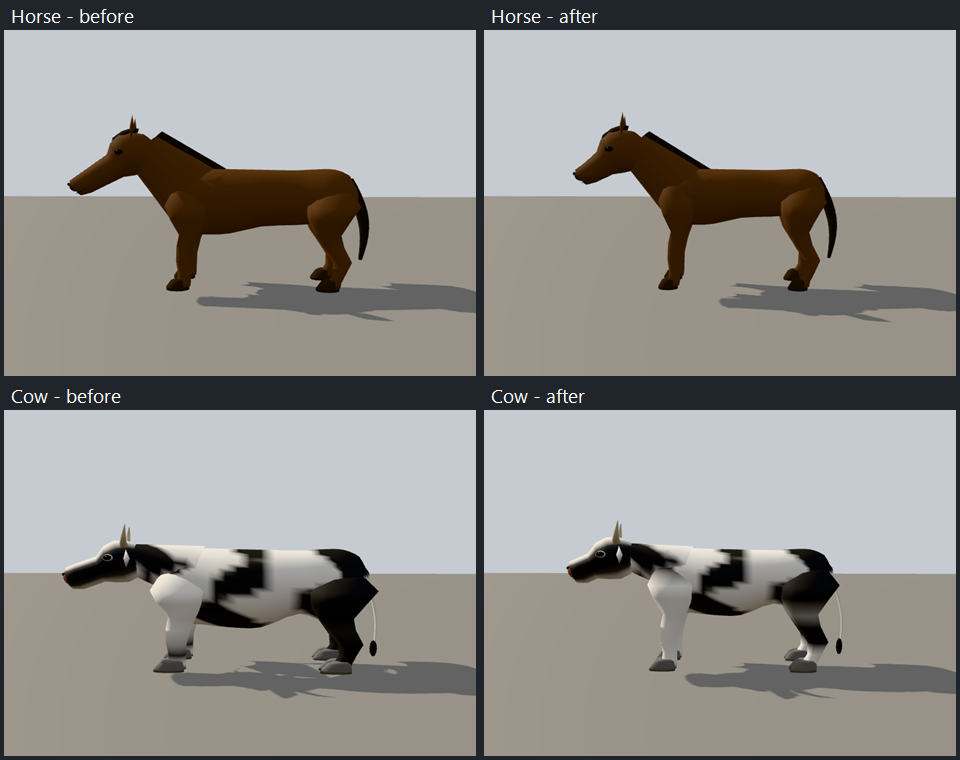
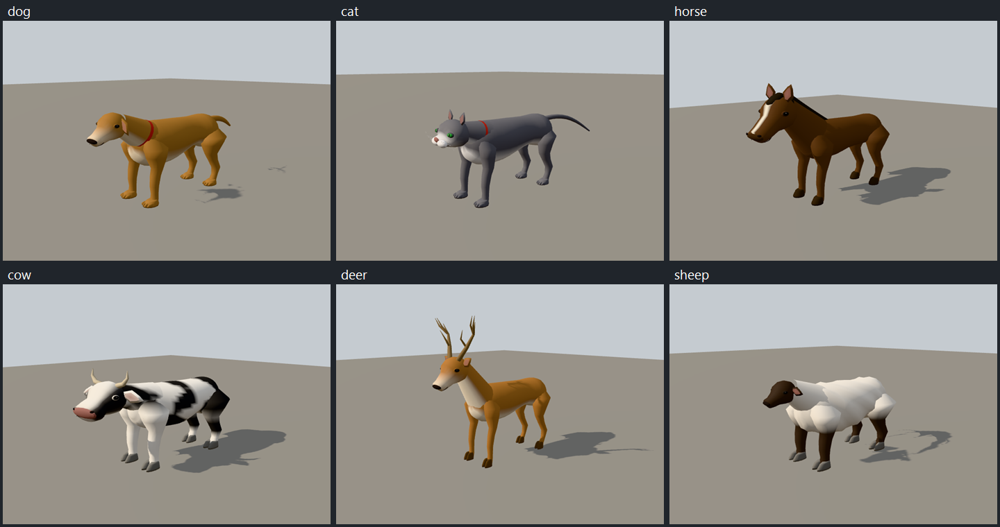

# Quadruped anatomy review

The dog, cat, horse, cow, deer and sheep procedural bodies now have species-shaped ribcages,
abdomen profiles, shoulders and haunches, shaped leg joints, continuous skull-to-muzzle
surfaces, modeled eyes and lips, cupped ears, and grounded paws or hooves. Cat eyes face
forward; horse manes follow the neck crest; cow markings are on the visible hide; sheep
fleece has geometric relief. Tails and horns use transported curve frames to avoid twisted
surfaces. Existing descriptor controls, mirrored anatomy, 27-joint names and gait APIs remain.

Withers heights remain 0.60 m (dog), 0.28 m (cat), 1.55 m (horse), 1.35 m (cow), 1.05 m
(deer) and 0.80 m (sheep). A deeper ribcage changes the derived leg scale while retaining
grounded soles and the exact withers height. Cat necks are shorter. The style is modeled,
gently faceted game geometry with one shared vertex-color material; there are no bitmap
textures, external model dependencies or generated-image prompts.

The default muzzles are compact, with the largest reduction on the horse and cow. Body-length
ratios range from 1.22 to 1.45 times withers height; horse and cow leg ratios are 1.30 and 1.20,
respectively. Their longer legs and shallower torsos retain the same withers height and ground
contact. These are preset defaults; explicit descriptor overrides still control proportions.



| Preset | Near triangles | Medium | Distant |
| --- | ---: | ---: | ---: |
| Dog | 4,554 | 2,538 | 1,148 |
| Cat | 5,034 | 2,874 | 1,148 |
| Horse | 4,258 | 2,162 | 1,216 |
| Cow | 6,442 | 2,466 | 1,480 |
| Deer | 4,474 | 2,506 | 1,492 |
| Sheep | 4,130 | 2,194 | 1,324 |



## Reproduce

Build the figure package and the tooling capture harness, then run from the repository root:

```sh
node scripts/review-animals.mjs --out .artifacts/animal-review/current
```

`--quick` renders only the six hero views. `--species dog,cat` restricts iteration to selected
presets. Configure `PLAYWRIGHT_BROWSERS_PATH` if Chromium is installed outside Playwright's
default cache. Windows sandbox sessions may need an escalated browser invocation for the
local capture server.

The full pass captures front/side/hero, walk/run and both lower tiers for each animal; it
exports six skinned GLBs, imports each into its own local project as `review.<preset>`, verifies
the sidecar, and captures four imported-model turntable angles. All 66 images were inspected.
Bulk images, source/imported GLBs and the full capture report stay under ignored `.artifacts/`.
`verification.json` retains source/model hashes, mesh budgets and the validation summary.
These runtime procedural models do not add an asset-build or asset-lock entry.

## Checks and limits

Figure tests cover deterministic buffers, symmetry, finite/unit normals, skin weights,
grounded feet, tier budgets, eye visibility, feature overrides, nondegenerate triangles and
curve-frame winding. Figure and ambient suites, the browser figure regression, figure
typecheck, scoped lint and deterministic-math checks pass. This model-only iteration did not
run repository-wide CI or unrelated generators.

The existing walk/trot/gallop foundation is retained. Uneven-ground foot planting and
quadruped IK remain unavailable; the distant tier remains rigid. Faces and toes are fixed
geometry on the existing bones, without facial expressions or toe articulation. The review
GLBs are local QA artifacts, not a public skinned-GLB bake API.
